# Roadmap to the five public theorems

Reviewed against `origin/main` at `049546b` on 2026-11-08.
Targets: the five fields of [`Audit.Public.CORRECT`](theories/Audit.v).
All five remain unproved. The safety statement on this branch concerns
declarative `Admissible`/`Runs`, independently of executable build/run.

**120 nodes:** 29 done, 0 partial, 91 open.
Of the unfinished nodes, **43** have a tentative ≤1h estimate once their
prerequisites are discharged; **48** are explicitly **? needs decomposition**.
These counts are not a total time estimate. Completed component results
are kept at useful statement granularity, rather than split into historical hour-sized work.

- **✓ Done (green):** the exact component statement/definition exists; its stated
  hypotheses remain part of that result. A conditional lemma is not a universal certificate.
- **◐ Partial (amber):** relevant implementation or proof material exists; the finish condition is open.
  This does not claim an agent is currently running.
- **○ Open (gray):** the finish condition is not established, with a tentative hour estimate.
- **? No credible hour estimate (purple):** keep this task visible until it has
  concrete subgoals; do not count a design note as completion of its proof.
  Purple overrides the status color; ✓/◐/○ still record the task's completion status.

The ≤1h estimates are planning judgments based on the proposed strategy,
not measured or guaranteed bounds. They assume the prerequisites supply
the invariant/representation they promise. If a node overruns an hour,
report the remaining obstruction and refine its prerequisites before continuing autonomously.

**Ready frontier:** tentative hour tasks: F07, F08, B01.
Ready tasks requiring decomposition: F10, T02, E01, L01.

## Selected plan and next checkpoint

- Build from an explicit finite source snapshot. A01/A02 now implement the public input contract and exact lookup/domain facts; loader and elaborator completeness remain open.
- Make Audit the common semantic target. Executable elaboration emits public programs directly; selected runtime lowering compiles that representation to the fast engine.
- Retain lazy closures and both fast-path/pruning effects for the initial port: default passed in 38m08s and all three reduced configurations timed out at one hour. The fully integrated public-target pipeline must still pass X14.
- Prove semantic safety directly against Audit. It can proceed independently of executable migration, host implementation and build/run agreement.
- Defer certificate-producing elaboration and the optional staged immutable-lowering candidate. Reconsider them only if evidence favors that route.

The initial architecture checkpoint is complete ahead of its two-hour deadline; see PUBLIC-FOUNDATION.md and the pinned benchmark record. The next frontier is T02 public runtime invariants, E01 public metadata/world reading, and F07/F08 input-bounded loader traversal. At subsequent two-hour active-work checkpoints, report proved results, measurements and remaining obstructions; do not silently extend the checkpoint.

Every local bootstrap run has a one-hour cap and runs in the background. Candidate timeouts are evidence for configuration selection; X14 must eventually pass for the fully integrated pipeline. Keep quiet full Rocq compilation around two minutes and use incremental checks during proof development.

## One dependency DAG

Arrows point from prerequisite to task; all incoming prerequisites are needed
for this proposed route. The five double-bordered nodes are the only sinks.
Groups organize the same graph; they are not additional task nodes.

Architecture/measurement nodes and X14 are engineering prerequisites for the
selected deliverable. They are not extra hypotheses in the five theorem statements.

```mermaid
flowchart TB
  subgraph A_group["Architecture and performance gates"]
    A01["✓ A01: Specify finite-source contract"]:::done
    A02["✓ A02: Implement finite-source lookup"]:::done
    A03["✓ A03: Prototype common semantic target"]:::done
    A04["✓ A04: Measure current bootstrap baseline"]:::done
    A05["✓ A05: Set up engine configuration comparison"]:::done
    A06["✓ A06: Measure candidate engine configurations"]:::done
    A07["✓ A07: Choose measured implementation boundary"]:::done
  end
  subgraph F_group["Shared front end and direct completeness"]
    F01["✓ F01: Lexer soundness"]:::done
    F02["✓ F02: Lexer completeness"]:::done
    F03["✓ F03: Parser soundness"]:::done
    F04["✓ F04: Parser completeness"]:::done
    F05["✓ F05: Loader soundness"]:::done
    F07["○ F07: Loader coverage invariant"]:::open
    F08["○ F08: Loader import / prelude traversal"]:::open
    F09["○ F09: Assemble loader completeness"]:::open
    F10["○ ? F10: Direct elaborator resource policy"]:::unknown
    F11["○ ? F11: Reverse world construction"]:::unknown
    F12["○ ? F12: Reverse contexts and signatures"]:::unknown
    F13["○ ? F13: Reverse expression elaboration"]:::unknown
    F14["○ ? F14: Reverse bindings and selection"]:::unknown
  end
  subgraph S_group["Reusable internal source components"]
    S01["✓ S01: Source-world reading"]:::done
    S02["✓ S02: Conditional body dispatcher"]:::done
    S03["✓ S03: Conditional fresh-link receipts"]:::done
    S04["✓ S04: Link-creator provenance"]:::done
    S05["✓ S05: Final functor rows"]:::done
    S06["✓ S06: Private snapshot readings"]:::done
    S07["✓ S07: Private scope allocation"]:::done
    S08["✓ S08: Private merge action"]:::done
    S09["✓ S09: Private capture preservation"]:::done
    S10["✓ S10: Runtime result export meanings"]:::done
    S29["✓ S29: Conditional function assembly"]:::done
  end
  subgraph P_group["Existing representation groundwork"]
    P01["✓ P01: Type/value representation definitions"]:::done
  end
  subgraph E_group["Direct public elaboration"]
    E01["○ ? E01: Interpret metadata in the public world"]:::unknown
    E02["○ ? E02: Emit public programs directly"]:::unknown
    E03["○ ? E03: Prove direct contexts/basic expressions"]:::unknown
    E04["○ ? E04: Prove direct call elaboration"]:::unknown
    E05["○ ? E05: Prove unified source bindings"]:::unknown
    E06["○ ? E06: Implement lexical capture/generation repair"]:::unknown
    E13["○ E13: Read public promised outputs"]:::open
    E14["○ E14: Prove public output availability"]:::open
    E15["○ E15: Prove public method refiling"]:::open
    E16["○ E16: Prove public result header"]:::open
    E07["○ E07: Assemble direct fresh-link validity"]:::open
    E08["○ ? E08: Prove direct cached/provider reuse"]:::unknown
    E09["○ ? E09: Prove direct main/platform emission"]:::unknown
    E17["○ ? E17: Cover direct ordinary function bodies"]:::unknown
    E18["○ ? E18: Cover direct generated provider bodies"]:::unknown
    E10["○ E10: Assemble direct final-state coverage"]:::open
    E11["○ ? E11: Close direct public elaboration soundness"]:::unknown
    E12["○ ? E12: Direct public elaboration completeness"]:::unknown
    E19["✓ E19: Emit public type metadata"]:::done
  end
  subgraph L_group["Selected runtime lowering"]
    L01["○ ? L01: Specify selected runtime lowering"]:::unknown
    L02["○ ? L02: Compile public expressions/bindings"]:::unknown
    L03["○ ? L03: Define fast environment invariant"]:::unknown
    L04["○ L04: Prove fast environment operations"]:::open
    L05["○ ? L05: Prove callable captures/exports"]:::unknown
    L06["○ ? L06: Relate runtime values/cast metadata"]:::unknown
    L07["○ ? L07: Prove supplied-interface adapter"]:::unknown
  end
  subgraph K_group["Public platform checks"]
    K01["○ K01: Check primitive signatures"]:::open
    K02["○ K02: Check machine and tag layouts"]:::open
    K03["○ K03: Check Ref/Array cast metadata"]:::open
    K04["○ K04: Check entry ABI"]:::open
    K05["○ ? K05: Check initial platform provisions"]:::unknown
    K06["○ K06: Assemble link-check soundness"]:::open
    K07["○ K07: Assemble link-check completeness"]:::open
    K09["○ ? K09: Implement public platform checker"]:::unknown
  end
  subgraph H_group["Default host"]
    H01["○ ? H01: Choose public host adapter"]:::unknown
    H02["○ H02: Numeric/structural primitive laws"]:::open
    H03["○ H03: Memory and I/O primitive laws"]:::open
    H04["○ ? H04: Relate concrete heap states"]:::unknown
    H05["○ H05: Public heap empty/weakening laws"]:::open
    H06["○ ? H06: Public GC/cast heap laws"]:::unknown
    H07["○ H07: Assemble default-interface laws"]:::open
  end
  subgraph T_group["Public semantic safety"]
    T01["✓ T01: Internal typed-runtime safety"]:::done
    T02["○ ? T02: Fix public runtime invariant"]:::unknown
    T03["○ T03: Public type-substitution lemmas"]:::open
    T04["○ T04: Public lookup/provision lemmas"]:::open
    T05["○ T05: Type basic source elaborations"]:::open
    T06["○ ? T06: Type source call elaborations"]:::unknown
    T07["○ ? T07: Type source bindings/captures"]:::unknown
    T08["○ T08: Type source control constructs"]:::open
    T09["○ ? T09: Type generated providers"]:::unknown
    T10["○ ? T10: Derive program/entry invariants"]:::unknown
    T11["○ T11: Generic compatible primitive step"]:::open
    T12["○ T12: Runtime context extension lemmas"]:::open
    T13["○ T13: Preserve basic runtime forms"]:::open
    T14["○ ? T14: Preserve call execution"]:::unknown
    T15["○ ? T15: Preserve functor bindings"]:::unknown
    T16["○ ? T16: Preserve captures and exports"]:::unknown
    T17["○ ? T17: Preserve typed GC stores"]:::unknown
    T18["○ T18: Preserve control-flow signals"]:::open
    T19["○ ? T19: Close runtime preservation induction"]:::unknown
    T20["○ T20: Exclude entry Wrong signals"]:::open
    T21["○ ? T21: Type semantic platform initialization"]:::unknown
    T22["✓ T22: Preserve closed captured meanings"]:::done
  end
  subgraph X_group["Common-target executable agreement"]
    X01["✓ X01: Exact internal closure agreement"]:::done
    X02["✓ X02: Conditional optimized agreement"]:::done
    X03["○ ? X03: Choose interface-parametric engine"]:::unknown
    X04["○ X04: Simulate basic expression steps"]:::open
    X05["○ X05: Simulate calls and captures"]:::open
    X06["○ ? X06: Simulate functor binding steps"]:::unknown
    X07["○ ? X07: Simulate interface/state operations"]:::unknown
    X08["○ X08: Relate observations and results"]:::open
    X09["○ ? X09: Forward finite-fuel adequacy"]:::unknown
    X10["○ ? X10: Reverse finite-fuel adequacy"]:::unknown
    X11["○ ? X11: Discharge compiled-table preparation"]:::unknown
    X12["○ X12: Implement public run wrapper"]:::open
    X13["○ ? X13: Verify retained optional transformations"]:::unknown
    X14["○ ? X14: Validate integrated one-hour bootstrap"]:::unknown
  end
  subgraph B_group["Public build"]
    B01["○ B01: Fix public build configuration"]:::open
    B02["○ B02: Wire direct public elaboration"]:::open
    B03["○ B03: Define executable public build"]:::open
    B04["○ B04: Prove default compatibility"]:::open
    B05["○ B05: Assemble public build soundness"]:::open
    B06["○ ? B06: Assemble public build completeness"]:::unknown
  end
  subgraph G_group["Five public obligations"]
    G01[["○ G01: build_sound"]]:::open
    G02[["○ G02: build_complete"]]:::open
    G03[["○ G03: run_sound"]]:::open
    G04[["○ G04: run_complete"]]:::open
    G05[["○ G05: safety"]]:::open
  end
  F01 --> F03
  F02 --> F04
  F03 --> F05
  A02 --> F07
  F04 --> F07
  A02 --> F08
  F04 --> F08
  F07 --> F09
  F08 --> F09
  A02 --> F10
  F10 --> F11
  S01 --> F11
  E01 --> F11
  F11 --> F12
  E01 --> F12
  F12 --> F13
  E02 --> F13
  F12 --> F14
  E06 --> F14
  E01 --> K01
  K09 --> K01
  E01 --> K02
  K09 --> K02
  K02 --> K03
  K09 --> K03
  E01 --> K04
  K09 --> K04
  E02 --> K05
  K01 --> K05
  K09 --> K05
  K01 --> K06
  K02 --> K06
  K03 --> K06
  K04 --> K06
  K05 --> K06
  E02 --> K06
  K01 --> K07
  K02 --> K07
  K03 --> K07
  K04 --> K07
  K05 --> K07
  A07 --> H01
  L06 --> H01
  H01 --> H02
  L06 --> H02
  H01 --> H03
  L06 --> H03
  H01 --> H04
  H04 --> H05
  H04 --> H06
  L06 --> H06
  H02 --> H07
  H03 --> H07
  H05 --> H07
  H06 --> H07
  T02 --> T03
  T03 --> T04
  T04 --> T05
  T04 --> T06
  T04 --> T07
  T04 --> T08
  T06 --> T09
  T07 --> T09
  T05 --> T10
  T06 --> T10
  T07 --> T10
  T08 --> T10
  T09 --> T10
  T21 --> T10
  T02 --> T11
  T03 --> T12
  T04 --> T12
  T12 --> T13
  T11 --> T13
  T12 --> T14
  T06 --> T14
  T12 --> T15
  T07 --> T15
  T15 --> T16
  T12 --> T16
  T22 --> T16
  T12 --> T17
  T11 --> T17
  T13 --> T18
  T14 --> T18
  T01 --> T19
  T13 --> T19
  T14 --> T19
  T16 --> T19
  T17 --> T19
  T18 --> T19
  T19 --> T20
  T10 --> T20
  A07 --> X03
  L01 --> X03
  X03 --> X04
  L02 --> X04
  L04 --> X04
  X03 --> X05
  L05 --> X05
  X03 --> X06
  L05 --> X06
  L07 --> X07
  L06 --> X08
  X04 --> X08
  X05 --> X08
  X06 --> X08
  X07 --> X08
  X08 --> X09
  X13 --> X09
  X08 --> X10
  X13 --> X10
  X01 --> X11
  L02 --> X11
  X03 --> X12
  X11 --> X12
  L02 --> X12
  A02 --> B01
  F05 --> B02
  E02 --> B02
  K09 --> B02
  B01 --> B03
  B02 --> B03
  K06 --> B04
  H07 --> B04
  B03 --> B05
  B04 --> B05
  E11 --> B05
  F05 --> B05
  F09 --> B06
  E12 --> B06
  K07 --> B06
  B03 --> B06
  B05 --> G01
  B06 --> G02
  X09 --> G03
  X12 --> G03
  X14 --> G03
  X10 --> G04
  X12 --> G04
  X14 --> G04
  T20 --> G05
  A01 --> A02
  P01 --> A03
  X01 --> A05
  X02 --> A05
  A05 --> A06
  A03 --> A07
  A04 --> A07
  A06 --> A07
  S01 --> E01
  A03 --> E01
  E19 --> E01
  A03 --> E02
  E01 --> E02
  E02 --> E03
  E01 --> E03
  S02 --> E03
  E03 --> E04
  E03 --> E05
  E02 --> E06
  S06 --> E06
  S07 --> E06
  S08 --> E06
  S09 --> E06
  S10 --> E06
  E05 --> E13
  E06 --> E13
  S03 --> E13
  E13 --> E14
  E14 --> E15
  E13 --> E16
  E13 --> E07
  E14 --> E07
  E15 --> E07
  E16 --> E07
  E07 --> E08
  E06 --> E08
  S04 --> E08
  S05 --> E08
  E02 --> E09
  E03 --> E09
  E03 --> E17
  E04 --> E17
  S29 --> E17
  E04 --> E18
  E05 --> E18
  E08 --> E18
  E17 --> E10
  E18 --> E10
  E09 --> E10
  E03 --> E11
  E04 --> E11
  E05 --> E11
  E07 --> E11
  E08 --> E11
  E10 --> E11
  F10 --> E12
  F11 --> E12
  F12 --> E12
  F13 --> E12
  F14 --> E12
  E02 --> E12
  A07 --> L01
  X01 --> L01
  L01 --> L02
  L01 --> L03
  L03 --> L04
  L02 --> L05
  L04 --> L05
  L01 --> L06
  L06 --> L07
  X03 --> L07
  A02 --> K09
  E01 --> K09
  T02 --> T21
  T04 --> T21
  A07 --> X13
  X02 --> X13
  T20 --> X13
  A07 --> X14
  X12 --> X14
  B03 --> X14
  H01 --> X14
  classDef done stroke:#238636,stroke-width:2px
  classDef partial stroke:#b8860b,stroke-width:2px,stroke-dasharray:5 3
  classDef open stroke:#888,stroke-dasharray:2 3
  classDef unknown stroke:#8250df,stroke-width:2px,stroke-dasharray:7 3
```



## Finish conditions, strategy and evidence

Links on unfinished tasks are starting points, not proof-completion claims.
Some ? nodes are deliberately broad: their constructor-level breakdown depends
on earlier design decisions. No remaining universal result is hidden behind
an estimate of one hour just because its final assembly has a short name.

### Architecture and performance gates

| Task | Status / budget | Finish condition | Strategy and evidence |
| --- | --- | --- | --- |
| **A01** Specify finite-source contract | ✓ done; Proved / defined | Specify an explicit finite source snapshot, canonical path lookup and the intended Builds/build signatures, including how the executable receives its finite inventory. | Retain the five public obligations and intended finite-filesystem meaning. Record the exact proposed type/loader changes before implementing them. [PUBLIC-FOUNDATION.md](PUBLIC-FOUNDATION.md), [Audit.v](theories/Audit.v) |
| **A02** Implement finite-source lookup | ✓ done; Proved / defined | Implement the selected source representation and read adapter; establish lookup, uniqueness and finite-inventory facts without silently imposing arbitrary fuel caps. | Keep ordinary lexing/parsing shared. Split source constructors, path handling and loader adapter proofs after A01 fixes their statements. Named result: `source_read_iff`. [SourceSnapshot.v](theories/SourceSnapshot.v), [AuditBuildExample.v](theories/AuditBuildExample.v) |
| **A03** Prototype common semantic target | ✓ done; Proved / defined | Produce a precise direct-Audit elaborator target and runtime-lowering boundary, with a checked representative operation and capture/output-generation/GC-cast behavior evidence. | The proposal, direct type emitter and partial public closure compiler are implemented. The closed capture/output/cast fixture discharges its table premise. Full language emission, recursive tables, fast caches and production integration remain separate tasks. Named result: `all_fuel_agreement`. [PUBLIC-FOUNDATION.md](PUBLIC-FOUNDATION.md), [PublicEmit.v](theories/PublicEmit.v), [PublicClosurePrototype.v](theories/PublicClosurePrototype.v), [PublicClosureExample.v](theories/PublicClosureExample.v) |
| **A04** Measure current bootstrap baseline | ✓ done; Proved / defined | Record source/executable hashes, elapsed time and compiler fixpoint for the current production pipeline on the local x86 VM, or a measured timeout/failure. | The pinned current production pipeline passed the complete compiler fixpoint in 2287.697 seconds. The frozen oracle is byte-identical to the newly checked build; see the checkpoint record and raw benchmark outputs. [benchmark-configs.py](benchmark-configs.py), [foundation-2026-11-08.json](benchmarks/foundation-2026-11-08.json), [PUBLIC-FOUNDATION.md](PUBLIC-FOUNDATION.md) |
| **A05** Set up engine configuration comparison | ✓ done; Proved / defined | Specify reproducible comparisons of the closure engine with optional fast-path/pruning passes enabled or disabled, including common inputs and expected results. | Use MOSS_FASTPATH/MOSS_PRUNE controls; distinguish exact closure agreement from outer optimization exceptions. Prepare capped background runs. [benchmark-configs.py](benchmark-configs.py), [moss_m2.ml](ocaml/moss_m2.ml), [LazyCloFacts.v](theories/LazyCloFacts.v) |
| **A06** Measure candidate engine configurations | ✓ done; Proved / defined | Collect timed fixpoint/regression results, or explicit capped failures, for the candidate production configurations. | Measured all four configurations against one frozen input/oracle: default passed in 2287.697 seconds; each reduced configuration timed out at one hour during S1 generation. Timed-out configurations are not eligible passing pipelines. [benchmark-configs.py](benchmark-configs.py), [foundation-2026-11-08.json](benchmarks/foundation-2026-11-08.json) |
| **A07** Choose measured implementation boundary | ✓ done; Proved / defined | Choose the common public program target, exact lowering/closure boundary and required optimization passes using prototype and performance evidence. | Select direct public program emission and local closure/environment lowering. Retain lazy closures and both optional transformations for the initial port because reduced configurations missed the cap. Actual port correctness, concrete lowered invariants and integrated X14 performance remain open. [PUBLIC-FOUNDATION.md](PUBLIC-FOUNDATION.md), [foundation-2026-11-08.json](benchmarks/foundation-2026-11-08.json), [PublicClosurePrototype.v](theories/PublicClosurePrototype.v) |

### Shared front end and direct completeness

| Task | Status / budget | Finish condition | Strategy and evidence |
| --- | --- | --- | --- |
| **F01** Lexer soundness | ✓ done; Proved / defined | Successful lexing implies Lexes. | Existing proof. Named result: `lex_sound`. [FrontEnd.v](theories/FrontEnd.v) |
| **F02** Lexer completeness | ✓ done; Proved / defined | Lexes implies successful lexing of the specified tokens. | Existing proof. Named result: `lex_complete`. [FrontEnd.v](theories/FrontEnd.v) |
| **F03** Parser soundness | ✓ done; Proved / defined | Successful parsing implies Derives. | Existing proof. Named result: `parse_moss_sound`. [FrontEnd.v](theories/FrontEnd.v) |
| **F04** Parser completeness | ✓ done; Proved / defined | Derives implies successful parsing. | Existing proof. Named result: `parse_moss_complete`. [FrontEndComplete.v](theories/FrontEndComplete.v) |
| **F05** Loader soundness | ✓ done; Proved / defined | Successful load implies Loader.Bundled. | Existing proof; no completeness claim. Named result: `load_sound`. [FrontEndLoader.v](theories/FrontEndLoader.v) |
| **F07** Loader coverage invariant | ○ open; ≤1h, tentative | A loader worklist invariant covers every module of a finite-source Bundled witness with justified input-derived bounds. | Induct over the finite witness/rank using the source contract and algorithm established by A01/A02. [FrontEndLoader.v](theories/FrontEndLoader.v), [Parse.v](theories/Parse.v) |
| **F08** Loader import / prelude traversal | ○ open; ≤1h, tentative | Traversal preserves path canonicalization, module uniqueness, explicit imports and implicit-prelude closure without losing required files. | Prove the worklist step cases under F07-compatible invariants. [FrontEndLoader.v](theories/FrontEndLoader.v), [Parse.v](theories/Parse.v) |
| **F09** Assemble loader completeness | ○ open; ≤1h, tentative | Every Bundled witness is accepted by the configured executable loader. | Combine coverage, path/import cases and the termination policy; conclude the whole loader result. [FrontEndLoader.v](theories/FrontEndLoader.v), [ComponentContracts.v](theories/ComponentContracts.v) |
| **F10** Direct elaborator resource policy | ○ open; ? Decompose | Replace or justify declaration/type/elaboration budgets for all public-buildable finite-source inputs. | Audit recursion in the direct public elaborator and derive bounds or terminating algorithms. A finite file list alone does not establish elaborator completeness. [Elab.v](theories/Elab.v) |
| **F11** Reverse world construction | ○ open; ? Decompose | Construct an executable world/metadata reading from a public declarative world, up to the fresh names allowed by build completeness. | Invert public WorldOf using the direct metadata interpretation; split scope, shadowing and requirement cases. [WorldSound.v](theories/WorldSound.v), [ReqsTotal.v](theories/ReqsTotal.v) |
| **F12** Reverse contexts and signatures | ○ open; ? Decompose | Public declarative contexts, signatures and type readings are accepted by the direct executable elaborator. | Prove the backward directions of the direct public context/checking operations; no whole-program model back-translation. [CtxWalk.v](theories/CtxWalk.v), [ProviderSig.v](theories/ProviderSig.v), [ComponentContracts.v](theories/ComponentContracts.v) |
| **F13** Reverse expression elaboration | ○ open; ? Decompose | Public expression derivations admit successful direct executable elaboration, with the chosen fresh symbols. | Separate source expression constructors and expected-type checking once the direct context invariant is fixed. [Elab.v](theories/Elab.v), [Audit.v](theories/Audit.v) |
| **F14** Reverse bindings and selection | ○ open; ? Decompose | Public binding/provider/family derivations yield successful direct executable checks with coherent captures and fresh outputs. | Split unified binding forms, selection and recursive demand against the public rules. [Elab.v](theories/Elab.v), [ComponentContracts.v](theories/ComponentContracts.v) |

### Reusable internal source components

| Task | Status / budget | Finish condition | Strategy and evidence |
| --- | --- | --- | --- |
| **S01** Source-world reading | ✓ done; Proved / defined | Successful internal elaboration constructs a correct source world and requirement reading. | Existing proof; field-number injection remains explicit. Named result: `elaborate_world_of`. [ReqsTotal.v](theories/ReqsTotal.v) |
| **S02** Conditional body dispatcher | ✓ done; Proved / defined | Pending follows from the existing construct lemmas assuming Hnonmethod_remainingbind and the section world hypotheses. | Existing conditional internal proof. Reuse its construct lemmas in E03; E11 closes the direct public port's remaining callbacks. Named result: `pending`. [BodyPending.v](theories/BodyPending.v) |
| **S03** Conditional fresh-link receipts | ✓ done; Proved / defined | Fresh execution supplies context, capture, body and allocation receipts under OneStep, invariants and final-state premises. | Existing conditional proof; excludes the output certificate. Named result: `link_body_fresh_data`. [LinkBodySound.v](theories/LinkBodySound.v) |
| **S04** Link-creator provenance | ✓ done; Proved / defined | Actual whole-program execution preserves authenticated cached-link creators. | Existing provenance proof, not semantic validity. Named result: `elab_init_link_inv`. [LinkProgramPreserve.v](theories/LinkProgramPreserve.v) |
| **S05** Final functor rows | ✓ done; Proved / defined | Actual final and historical functor rows agree with the program tables. | Existing proof. Named result: `elab_program_final_links`. [FunctorRowsProgram.v](theories/FunctorRowsProgram.v) |
| **S06** Private snapshot readings | ✓ done; Proved / defined | Scoped types retain their semantic lookup under the stated snapshot assumptions. | Existing helper proof; not actual link_body integration. Named result: `scoped_type_read`. [InputGenerationScope.v](theories/InputGenerationScope.v) |
| **S07** Private scope allocation | ✓ done; Proved / defined | A finite private generation scope is connected to actual fresh symbol allocations. | Existing allocation helpers. Named result: `reserved_link_input_plan`. [InputGenerationAllocate.v](theories/InputGenerationAllocate.v) |
| **S08** Private merge action | ✓ done; Proved / defined | Private snapshots preserve the source merge action under their explicit scope assumptions. | Existing merge helpers. Named result: `private_canon_read`. [InputGenerationMerge.v](theories/InputGenerationMerge.v) |
| **S09** Private capture preservation | ✓ done; Proved / defined | Captured private meanings survive caller rebinding under the explicit transfer assumptions. | Existing helper theorem. Named result: `private_capture_grounding_survives_caller_rebinding`. [InputGenerationRuntime.v](theories/InputGenerationRuntime.v) |
| **S10** Runtime result export meanings | ✓ done; Proved / defined | Result transfers install the exported type meaning at the caller generation. | Existing runtime repair and lookup/grounding proof. Named result: `frame_result_private_grounding`. [InputGenerationExports.v](theories/InputGenerationExports.v) |
| **S29** Conditional function assembly | ✓ done; Proved / defined | Completed function traces yield FnElab under Pending, Later and final body agreement. | Existing conditional proof. Named result: `completed_history_fn_elab`. [FnElabExec.v](theories/FnElabExec.v) |

### Existing representation groundwork

| Task | Status / budget | Finish condition | Strategy and evidence |
| --- | --- | --- | --- |
| **P01** Type/value representation definitions | ✓ done; Proved / defined | Explicit type_represents and value_represents relations exist. | Definitions only; this done node claims no totality, simulation or whole-program correspondence. Named result: `value_represents`. [AuditRepresentation.v](theories/AuditRepresentation.v) |

### Direct public elaboration

| Task | Status / budget | Finish condition | Strategy and evidence |
| --- | --- | --- | --- |
| **E01** Interpret metadata in the public world | ○ open; ? Decompose | Define the direct executable metadata/context reading into Audit worlds, using shared source syntax and one source-symbol reading. | Reuse unchanged declaration/scope/requirement facts; isolate public type/context differences without a second whole-program elaboration model. [Audit.v](theories/Audit.v), [WorldSound.v](theories/WorldSound.v) |
| **E02** Emit public programs directly | ○ open; ? Decompose | Make executable elaboration emit Audit programs, expressions and unified bindings, retaining implementation metadata needed for checks. | Port emission by constructor, starting with the prototype. Preserve CLI/tests while keeping the semantic target fixed. [Audit.v](theories/Audit.v), [Elab.v](theories/Elab.v) |
| **E03** Prove direct contexts/basic expressions | ○ open; ? Decompose | Successful direct context/basic-expression operations implement the public elaboration rules, with explicit smaller-fuel hypotheses for recursive cases. | Port reusable component lemmas; decompose by source constructor. E11 must discharge all project callbacks in the global induction. [Audit.v](theories/Audit.v), [BodyPending.v](theories/BodyPending.v) |
| **E04** Prove direct call elaboration | ○ open; ? Decompose | Ordinary, method and family calls emitted by the executable satisfy the corresponding public judgments. | Port call lookup, satisfaction maps and demand cases directly to Audit; keep induction hypotheses explicit. [Audit.v](theories/Audit.v), [CallDefinedAny.v](theories/CallDefinedAny.v) |
| **E05** Prove unified source bindings | ○ open; ? Decompose | Successful ordinary/provider bindings implement the public unified binding judgments under explicit recursive hypotheses. | Split value/type/method/lambda/functor cases. Capture/output cases are supplied by E06-E08. [Audit.v](theories/Audit.v), [BindMethodExec.v](theories/BindMethodExec.v) |
| **E06** Implement lexical capture/generation repair | ○ open; ? Decompose | Actual public-target elaboration preserves lexical captures, fixed inputs and fresh outputs, including the known merged-input/output case. | Reuse private-generation preparations and the separate result-transfer repair. Integrate only what the direct public rules require; prove concrete receipts. [Audit.v](theories/Audit.v), [Elab.v](theories/Elab.v), [functor_input_output_generations.moss](../tests/regressions/functor_input_output_generations.moss) |
| **E13** Read public promised outputs | ○ open; ≤1h, tentative | Actual fresh-link execution supplies the public promised-result reading at the target inputs and fresh output generations. | Adapt the existing output-reading lemmas directly to the selected public emission invariant. [Audit.v](theories/Audit.v), [LinkOutputProvide.v](theories/LinkOutputProvide.v) |
| **E14** Prove public output availability | ○ open; ≤1h, tentative | Every promised fresh-link key is provided at its correct post-body meaning. | Port checked output-presence reasoning and discharge its concrete key-reading premises. [Audit.v](theories/Audit.v), [LinkOutputPresence.v](theories/LinkOutputPresence.v) |
| **E15** Prove public method refiling | ○ open; ≤1h, tentative | Actual method aliases/refiling match the public renamed promised output keys. | Use the fixed public generation reading to prove the alias equality. [Audit.v](theories/Audit.v), [LinkOutputRefile.v](theories/LinkOutputRefile.v) |
| **E16** Prove public result header | ○ open; ≤1h, tentative | The emitted public result telescope agrees with declared outputs under the chosen fresh generations. | Port allocation/index/header reasoning without adding a whole-program representation layer. [Audit.v](theories/Audit.v), [LinkOutputIndex.v](theories/LinkOutputIndex.v) |
| **E07** Assemble direct fresh-link validity | ○ open; ≤1h, tentative | Actual fresh-linked code satisfies public LinkBody, retaining only the ordinary induction/invariant premises. | Assemble promised reading, availability, aliases and emitted header. [Audit.v](theories/Audit.v), [LinkBodySound.v](theories/LinkBodySound.v) |
| **E08** Prove direct cached/provider reuse | ○ open; ? Decompose | Reusing cached generated bodies preserves the public link/provider judgments and their lexical generation readings. | Reuse authenticated creator/final-row facts where applicable; prove semantic validity directly in the public model. [Audit.v](theories/Audit.v), [LinkCacheInvariant.v](theories/LinkCacheInvariant.v) |
| **E09** Prove direct main/platform emission | ○ open; ? Decompose | The actual emitted main, initial semantic provisions and Bool reading meet the public elaboration relation. | Adapt actual main/frame/Bool receipts to public program fields; keep executable platform checking separate. [Audit.v](theories/Audit.v), [MainProgramTrace.v](theories/MainProgramTrace.v), [MainProgramBool.v](theories/MainProgramBool.v) |
| **E17** Cover direct ordinary function bodies | ○ open; ? Decompose | Every defined source function has a public function-elaboration receipt in the final program, under explicit global induction premises. | Port completed-body coverage and final lookup transport; keep final-state obligations visible. [Audit.v](theories/Audit.v), [FnCompleted.v](theories/FnCompleted.v), [FnElabExec.v](theories/FnElabExec.v) |
| **E18** Cover direct generated provider bodies | ○ open; ? Decompose | Generated lambda, wrapper, forwarder and linked bodies have final public elaboration receipts. | Inventory emission forms and split their coverage proofs rather than assuming a generated-body callback. [Audit.v](theories/Audit.v), [FinalLambdas.v](theories/FinalLambdas.v), [FinalForwarders.v](theories/FinalForwarders.v) |
| **E10** Assemble direct final-state coverage | ○ open; ≤1h, tentative | One final public program/world contains all required source/generated body and initial-environment receipts. | Assemble coverage and monotonic final-table facts under clearly stated smaller-fuel assumptions. [Audit.v](theories/Audit.v), [FunctionFrameProgram.v](theories/FunctionFrameProgram.v) |
| **E11** Close direct public elaboration soundness | ○ open; ? Decompose | Every successful direct executable elaboration satisfies public ElaboratesIn with no unresolved project callbacks. | Close the mutual fuel/final-state induction. Do not first complete internal elaborate_sound and then prove a second source-model refinement. [Audit.v](theories/Audit.v), [Elab.v](theories/Elab.v) |
| **E12** Direct public elaboration completeness | ○ open; ? Decompose | Every public-buildable bundle is accepted by direct elaboration, with the implementation fresh names permitted by the public contract. | Assemble backward rule proofs and justified resource bounds, including the direct entry environment. [Audit.v](theories/Audit.v), [Elab.v](theories/Elab.v) |
| **E19** Emit public type metadata | ✓ done; Proved / defined | Direct type emission preserves structural field names and commutes with the existing input-bounded executable type substitution. | Verified emit_type and emit_full_substitution. This does not establish context meaning, machine initialization or whole elaboration soundness. Named result: `emit_full_substitution`. [PublicEmit.v](theories/PublicEmit.v) |

### Selected runtime lowering

| Task | Status / budget | Finish condition | Strategy and evidence |
| --- | --- | --- | --- |
| **L01** Specify selected runtime lowering | ○ open; ? Decompose | Fix the closure/lowering relation from public runtime code to the selected fast representation, including all valid-domain premises. | Keep a single semantic language. Any numeric IDs/maps/caches are local implementation choices with explicit correspondence lemmas. [Audit.v](theories/Audit.v), [LazyCloFacts.v](theories/LazyCloFacts.v) |
| **L02** Compile public expressions/bindings | ○ open; ? Decompose | Implement selected closure compilation directly from public expressions and unified bindings. | Port constructors and callable tables; split nonstructural lowering operations after L01 fixes the representation. [Audit.v](theories/Audit.v), [LazyClo.v](theories/LazyClo.v) |
| **L03** Define fast environment invariant | ○ open; ? Decompose | Relate fast provision/type/local environments and caches to the public environments without a whole-program model translation. | Specify map lookup, deferred substitutions and captured environments separately. [Audit.v](theories/Audit.v), [LazyEnvFacts.v](theories/LazyEnvFacts.v) |
| **L04** Prove fast environment operations | ○ open; ≤1h, tentative | Selected lookup, append, instantiation and grounding operations preserve the public environment relation. | Adapt existing map/deferred-substitution lemmas to the selected representation. [Audit.v](theories/Audit.v), [LazyEnvFacts.v](theories/LazyEnvFacts.v) |
| **L05** Prove callable captures/exports | ○ open; ? Decompose | Compiled closures retain public lexical captures, callable input interfaces and output-generation exports. | Split closure creation, call entry and result export; this proof concerns public runtime behavior, independently of executable build success. [Audit.v](theories/Audit.v), [LazyCloFacts.v](theories/LazyCloFacts.v) |
| **L06** Relate runtime values/cast metadata | ○ open; ? Decompose | Selected value/address/cast encodings preserve public value shapes and metadata lookups, or are proved identity where representations are shared. | Prove only conversions actually retained after A07; split checked-handle and record cases if necessary. [Audit.v](theories/Audit.v), [AuditRepresentation.v](theories/AuditRepresentation.v) |
| **L07** Prove supplied-interface adapter | ○ open; ? Decompose | The engine adapter invokes the same supplied interface and preserves its values, outcomes and external state. | Prove actual call correspondence for arbitrary compatible interfaces; typed signatures alone are insufficient. [Audit.v](theories/Audit.v), [DefaultRuntime.v](theories/DefaultRuntime.v) |

### Public platform checks

| Task | Status / budget | Finish condition | Strategy and evidence |
| --- | --- | --- | --- |
| **K01** Check primitive signatures | ○ open; ≤1h, tentative | A source primitive-signature checker agrees with public AtKey/MethodPrimitive conditions for the relevant entries. | Prove the checker clauses against the shared source world. [Audit.v](theories/Audit.v) |
| **K02** Check machine and tag layouts | ○ open; ≤1h, tentative | A layout checker agrees with public Layouts, including machine declarations and Bool/tag payload layouts. | Handle the finite designated layout cases using E01 lookups. [Audit.v](theories/Audit.v) |
| **K03** Check Ref/Array cast metadata | ○ open; ≤1h, tentative | The cast metadata checker agrees with public Representations. | Combine CastEntry cases and exact generated metadata shape. [Audit.v](theories/Audit.v) |
| **K04** Check entry ABI | ○ open; ≤1h, tentative | Executable entry checks agree with EntryPoint, including recursively zero-lane EntryResult cases. | Use signature lookup and structural result-layout checking. [Audit.v](theories/Audit.v), [EntryShape.v](theories/EntryShape.v) |
| **K05** Check initial platform provisions | ○ open; ? Decompose | The initial environment/family checker agrees with public Entry and Family judgments. | Generated platform-family bindings and provision keys may need further decomposition. [Audit.v](theories/Audit.v), [ReifyPlatform.v](theories/ReifyPlatform.v) |
| **K06** Assemble link-check soundness | ○ open; ≤1h, tentative | Successful public platform checking implies Linked in the elaboration world. | Assemble EntryPoint, Layouts, Representations and initial entries. [Audit.v](theories/Audit.v) |
| **K07** Assemble link-check completeness | ○ open; ≤1h, tentative | Linked implies acceptance by the public platform checker under the chosen representation. | Compose the backward directions of the component checker equivalences. [Audit.v](theories/Audit.v) |
| **K09** Implement public platform checker | ○ open; ? Decompose | Implement finite checks for public Linked using the same source world as direct elaboration. | Keep executable checker construction separate from its soundness/completeness proofs so runtime benchmarking can start early. [Audit.v](theories/Audit.v) |

### Default host

| Task | Status / budget | Finish condition | Strategy and evidence |
| --- | --- | --- | --- |
| **H01** Choose public host adapter | ○ open; ? Decompose | Define the concrete public host/state adapter used by the fixed default interface. | Settle value/address conversion and failure behavior without assuming host laws. [DefaultRuntime.v](theories/DefaultRuntime.v), [AuditRepresentation.v](theories/AuditRepresentation.v) |
| **H02** Numeric/structural primitive laws | ○ open; ≤1h, tentative | The public default host satisfies typed laws for non-memory numeric, record and tag operations. | Transport existing primitive cases through the chosen value relation; split operation groups if transport is not uniform. [MossX.v](theories/MossX.v), [DefaultRuntime.v](theories/DefaultRuntime.v) |
| **H03** Memory and I/O primitive laws | ○ open; ≤1h, tentative | Default linear-memory, arguments/file and I/O primitives preserve their public signatures and state behavior. | Reuse internal primitive laws through the host adapter. [MossX.v](theories/MossX.v), [DefaultRuntime.v](theories/DefaultRuntime.v) |
| **H04** Relate concrete heap states | ○ open; ? Decompose | Specify/prove the public heap predicate corresponding to the concrete heap, including address and held-type readings. | Separate heap-store representation from primitive stepping; decompose after adapter selection. [XHeapC.v](theories/XHeapC.v), [Audit.v](theories/Audit.v) |
| **H05** Public heap empty/weakening laws | ○ open; ≤1h, tentative | The public default heap predicate has the required empty-heap and weakening properties. | Transport existing concrete heap_empty and heap_mono. [XHeapC.v](theories/XHeapC.v), [DefaultRuntime.v](theories/DefaultRuntime.v) |
| **H06** Public GC/cast heap laws | ○ open; ? Decompose | Allocation, dereference, updates and checked casts satisfy public gc_pre/gc_post and heap preservation. | Establish held-type predicate conversion; split allocation/read/write/cast if it is not a uniform transport. [XHeapC.v](theories/XHeapC.v), [Audit.v](theories/Audit.v) |
| **H07** Assemble default-interface laws | ○ open; ≤1h, tentative | The chosen default interface satisfies every public interface_laws conjunct for every program view. | Assemble primitive, unsupported, non-GC and GC laws. [DefaultRuntime.v](theories/DefaultRuntime.v), [Audit.v](theories/Audit.v) |

### Public semantic safety

| Task | Status / budget | Finish condition | Strategy and evidence |
| --- | --- | --- | --- |
| **T01** Internal typed-runtime safety | ✓ done; Proved / defined | typed_runtime_program implies that internal run_main never returns XErr. | Existing proof; no assertion that all accepted programs have certificates. Named result: `typed_runtime_never_err`. [XElabTyped.v](theories/XElabTyped.v) |
| **T02** Fix public runtime invariant | ○ open; ? Decompose | Define public typing/provision/store invariants strong enough for safety of all admissible semantic programs. | Work directly with Audit judgments and the existing internal safety proof as reference. Do not wait for an executable port, program encoder or whole-model refinement. Scope invariants to the code justified by semantic derivations. [XTyping.v](theories/XTyping.v), [XSafety.v](theories/XSafety.v), [Audit.v](theories/Audit.v) |
| **T03** Public type-substitution lemmas | ○ open; ≤1h, tentative | Public typing/grounding admits the substitution and grounding facts required by runtime calls and result exports. | Structural proofs over the settled typing and environment judgments. [Audit.v](theories/Audit.v), [XTyping.v](theories/XTyping.v) |
| **T04** Public lookup/provision lemmas | ○ open; ≤1h, tentative | Typed environments provide correctly typed values, functions, methods and functors at the keys used by execution. | Invert the public environment/provision invariant. [Audit.v](theories/Audit.v), [XProvision.v](theories/XProvision.v) |
| **T05** Type basic source elaborations | ○ open; ≤1h, tentative | Public literal, record, tag and basic expression elaboration preserves the new runtime typing invariant. | Induct over the corresponding public elaboration rules. [Audit.v](theories/Audit.v) |
| **T06** Type source call elaborations | ○ open; ? Decompose | Ordinary, method and family-call elaborations yield correctly typed runtime calls. | Split call forms, satisfaction maps and generated methods once T02 is fixed. [Audit.v](theories/Audit.v), [XBridge.v](theories/XBridge.v) |
| **T07** Type source bindings/captures | ○ open; ? Decompose | Public BindItems and provider derivations preserve runtime provision/capture typing. | Split the unified binding grammar, closure creation and fresh output exports. [Audit.v](theories/Audit.v), [XBridgeCtx.v](theories/XBridgeCtx.v) |
| **T08** Type source control constructs | ○ open; ≤1h, tentative | Match, loop, return and branch elaboration preserve runtime typing and control permissions. | Induct over source control rules using the settled frame invariant. [Audit.v](theories/Audit.v) |
| **T09** Type generated providers | ○ open; ? Decompose | Lambda, forwarder, wrapper and linked-provider derivations generate typed callable code with correct interfaces. | Separate generated-body forms and discharge their closure environments. [Audit.v](theories/Audit.v), [ReifyContracts.v](theories/ReifyContracts.v) |
| **T10** Derive program/entry invariants | ○ open; ? Decompose | Every public ElaboratesIn plus Linked witness establishes runtime code validity and a typed initial entry environment. | Assemble the public semantic derivation; cover all admissible programs, not just executable build outputs. [Audit.v](theories/Audit.v) |
| **T11** Generic compatible primitive step | ○ open; ≤1h, tentative | Any compatible interface preserves the public typed result/store invariant for a primitive step. | Use Compatible.interface_laws; do not assume the interface is the default host. [Audit.v](theories/Audit.v) |
| **T12** Runtime context extension lemmas | ○ open; ≤1h, tentative | Grounding and provision typing survive the environment extensions and substitutions used by runtime evaluation. | Prove weakening and result-generation extension facts under explicit freshness. [Audit.v](theories/Audit.v), [XEnv.v](theories/XEnv.v) |
| **T13** Preserve basic runtime forms | ○ open; ≤1h, tentative | Variables, values, records, tags and primitive expressions preserve the public runtime invariant. | Prove evaluator case lemmas conditional on the smaller-fuel induction hypothesis. [Audit.v](theories/Audit.v), [XSafety.v](theories/XSafety.v) |
| **T14** Preserve call execution | ○ open; ? Decompose | Function/method calls preserve runtime typing and caller state/environment obligations. | Adapt the call cases after argument/callable invariants are fixed; split direct and provision calls if needed. [Audit.v](theories/Audit.v), [XSafety.v](theories/XSafety.v) |
| **T15** Preserve functor bindings | ○ open; ? Decompose | Executing unified functor/provider bindings produces correctly typed provision environments. | Split closure creation, input application and output-generation exports. [Audit.v](theories/Audit.v), [XSafety.v](theories/XSafety.v) |
| **T16** Preserve captures and exports | ○ open; ? Decompose | Captured lexical meanings and caller output generations satisfy runtime invariants after binding/application. | Prove capture and fresh-result preservation directly for public runtime environments and bindings; no executable-elaborator or old-model generation repair is a prerequisite. [Audit.v](theories/Audit.v), [InputGenerationRuntime.v](theories/InputGenerationRuntime.v) |
| **T17** Preserve typed GC stores | ○ open; ? Decompose | Public heap operations preserve store typing, checked handles and non-GC state invariants for any compatible interface. | Use generic heap laws with the public held-type interpretation, not concrete-host behavior. [Audit.v](theories/Audit.v), [XHeap.v](theories/XHeap.v) |
| **T18** Preserve control-flow signals | ○ open; ≤1h, tentative | Match/loop/return/break cases preserve typing and rule out misplaced control signals at the entry boundary. | Case analysis using the frame/control permission invariant. [Audit.v](theories/Audit.v), [XSafety.v](theories/XSafety.v) |
| **T19** Close runtime preservation induction | ○ open; ? Decompose | Assemble all public expression/binding/application preservation cases by fuel induction. | Port the internal induction pattern, exposing any missing evaluator cases as new tasks. [Audit.v](theories/Audit.v), [XSafety.v](theories/XSafety.v) |
| **T20** Exclude entry Wrong signals | ○ open; ≤1h, tentative | For an admissible public program and compatible interface, reference run_main cannot yield Stuck or escaping Breaking at any fuel. | Apply preservation to the typed entry environment; invert the allowed top-level signals. [Audit.v](theories/Audit.v) |
| **T21** Type semantic platform initialization | ○ open; ? Decompose | Public Platform.Linked and the source context establish the typing of the semantic initial provisions and primitive families. | Invert the declarative platform rules. This proof does not require an executable platform checker or the concrete default-host implementation. [Audit.v](theories/Audit.v) |
| **T22** Preserve closed captured meanings | ✓ done; Proved / defined | Public grounding of a type is unchanged by a new caller behind a complete captured type scope; captured provision lookups are unchanged. | Prove substitution agreement on mentioned generations and left-prefix lookup stability directly against Audit. Completeness of the captured scope remains explicit; semantic binding validity must still establish it. Named result: `capture_ground_stable`. [PublicCaptureFacts.v](theories/PublicCaptureFacts.v) |

### Common-target executable agreement

| Task | Status / budget | Finish condition | Strategy and evidence |
| --- | --- | --- | --- |
| **X01** Exact internal closure agreement | ✓ done; Proved / defined | Compiled closures equal internal run_main when the table equations hold. | Existing theorem with explicit table premise. Named result: `crun_main_eq`. [LazyCloFacts.v](theories/LazyCloFacts.v) |
| **X02** Conditional optimized agreement | ✓ done; Proved / defined | The production pruning/fast/closure path agrees with internal reference execution, allowing its stated fuel/stuck exceptions. | Existing bound contract, not agreement with public Runs. Named result: `fast_engine_agrees`. [LazyOracle.v](theories/LazyOracle.v), [LazyCloFacts.v](theories/LazyCloFacts.v) |
| **X03** Choose interface-parametric engine | ○ open; ? Decompose | Parameterize the selected common-target engine by the actual supplied public interface and state. | Implement the interface strategy chosen at A07 while retaining the measured fast closure path; split remaining primitive dispatch/state operations. [LazyOracle.v](theories/LazyOracle.v), [Audit.v](theories/Audit.v) |
| **X04** Simulate basic expression steps | ○ open; ≤1h, tentative | Public basic-expression execution and its compiled closures correspond under explicit fuel/environment hypotheses. | Prove structural compiler case lemmas, using the common public syntax rather than translating between complete semantic languages. [AuditRepresentation.v](theories/AuditRepresentation.v), [LazyCloFacts.v](theories/LazyCloFacts.v) |
| **X05** Simulate calls and captures | ○ open; ≤1h, tentative | Compiled function/method calls preserve public callable and lexical-capture semantics. | Use the selected callable/environment invariant for call entry and return. [AuditRepresentation.v](theories/AuditRepresentation.v), [LazyCloFacts.v](theories/LazyCloFacts.v) |
| **X06** Simulate functor binding steps | ○ open; ? Decompose | Compiled unified binding, functor application and output scopes correspond to public execution. | Split closure creation, binding, application and export cases of the chosen compiler. [AuditRepresentation.v](theories/AuditRepresentation.v), [LazyCloFacts.v](theories/LazyCloFacts.v) |
| **X07** Simulate interface/state operations | ○ open; ? Decompose | Selected primitive/heap operations produce the same observed result and external state as the supplied public interface. | Apply the supplied-interface adapter theorem; retain heap/address conversion obligations only if the selected runtime needs them. [AuditRepresentation.v](theories/AuditRepresentation.v), [Audit.v](theories/Audit.v) |
| **X08** Relate observations and results | ○ open; ≤1h, tentative | Translated normal/exit/trap/unsupported/wrong signals and states agree with the public observe function. | Exhaust the finite signal constructors; keep OutOfFuel as absence of an observation. [Audit.v](theories/Audit.v) |
| **X09** Forward finite-fuel adequacy | ○ open; ? Decompose | Every selected-engine result on an admissible public program has a public Runs derivation. | Combine common-target compiler correspondence with verified retained transformations and explicit budget translation. [AuditRepresentation.v](theories/AuditRepresentation.v), [LazyOracle.v](theories/LazyOracle.v) |
| **X10** Reverse finite-fuel adequacy | ○ open; ? Decompose | Every public Runs derivation for an admissible program is reported by the selected engine at some finite budget. | Prove fuel adequacy for the common-target compiler and retained transformations. No reverse encoding into the old program language is required. [AuditRepresentation.v](theories/AuditRepresentation.v), [LazyOracle.v](theories/LazyOracle.v) |
| **X11** Discharge compiled-table preparation | ○ open; ? Decompose | The actual executable preparation supplies the table equations used by agreement, with the OCaml trust boundary stated precisely. | Discharge actual preparation equations for compilation from public programs, resolving the OCaml/extraction boundary explicitly; do not assume Prepared as the final guarantee. [ComponentContracts.v](theories/ComponentContracts.v), [moss_m2.ml](ocaml/moss_m2.ml) |
| **X12** Implement public run wrapper | ○ open; ≤1h, tentative | Define run on public programs, supplied interfaces, states and observation budgets using the selected executable path. | Compile the public program directly and connect the selected engine/preparer to observe; no old-model program encoder. [Audit.v](theories/Audit.v), [Certified.v](theories/Certified.v) |
| **X13** Verify retained optional transformations | ○ open; ? Decompose | The exact retained fast-path/pruning configuration preserves the observations needed by public run soundness and completeness. | Omitted passes need no port. For retained passes, adapt existing proofs and discharge fuel/stuck exceptions. If no passes are needed, prove the identity configuration. [FastPath.v](theories/FastPath.v), [Prune.v](theories/Prune.v), [LazyCloFacts.v](theories/LazyCloFacts.v) |
| **X14** Validate integrated one-hour bootstrap | ○ open; ? Decompose | The fully integrated selected public-target pipeline bootstraps the pinned compiler to a matching fixpoint within one hour on the local x86 VM. | Record source/executable/configuration hashes and timings. This is a release/performance gate, not a premise added to the logical theorem. Run in the background and investigate a capped failure. [flake.nix](../flake.nix), [moss_m2.ml](ocaml/moss_m2.ml) |

### Public build

| Task | Status / budget | Finish condition | Strategy and evidence |
| --- | --- | --- | --- |
| **B01** Fix public build configuration | ○ open; ≤1h, tentative | Fix the intended prelude and canonical finite-source/path configuration for the public build implementation. | Apply the finite-source contract; preserve intended filesystem behavior and explicit error handling. [Audit.v](theories/Audit.v) |
| **B02** Wire direct public elaboration | ○ open; ≤1h, tentative | Implement loading, direct public-program emission and public platform checking as one executable build path. | Wire the code before waiting for all soundness proofs, allowing background integration/performance tests. [Audit.v](theories/Audit.v), [Parse.v](theories/Parse.v), [Elab.v](theories/Elab.v) |
| **B03** Define executable public build | ○ open; ≤1h, tentative | Supply the real build field of Public.CORRECT, returning None on checked failure and public programs on success. | Define the real build function over the selected finite source snapshot, with no arbitrary-budget completeness loophole. [Audit.v](theories/Audit.v) |
| **B04** Prove default compatibility | ○ open; ≤1h, tentative | Public successful platform linkage implies compatibility with the chosen fixed default interface. | Combine Ready, full operation support and public interface laws. [Audit.v](theories/Audit.v), [DefaultRuntime.v](theories/DefaultRuntime.v) |
| **B05** Assemble public build soundness | ○ open; ≤1h, tentative | Build success implies public Builds and default compatibility. | Unfold the wrapper and combine loader soundness, public refinement and platform/host facts. [Audit.v](theories/Audit.v) |
| **B06** Assemble public build completeness | ○ open; ? Decompose | A public Builds witness makes the configured build return some program. | Compose loader, direct public elaborator and platform-check completeness; no intermediate internal-language completeness or model back-translation. [Audit.v](theories/Audit.v) |

### Five public obligations

| Task | Status / budget | Finish condition | Strategy and evidence |
| --- | --- | --- | --- |
| **G01** build_sound | ○ open; ≤1h, tentative | Implement the exact build_sound field of Audit.Public.CORRECT. | Bind the assembled proof without changing its public statement. [Audit.v](theories/Audit.v) |
| **G02** build_complete | ○ open; ≤1h, tentative | Implement the exact build_complete field of Audit.Public.CORRECT. | Bind the assembled proof; only existential output, not equality with an arbitrary witness, is promised. [Audit.v](theories/Audit.v) |
| **G03** run_sound | ○ open; ≤1h, tentative | Implement the exact run_sound field for admissible programs and compatible interfaces. | Connect the wrapper to forward execution adequacy. [Audit.v](theories/Audit.v) |
| **G04** run_complete | ○ open; ≤1h, tentative | Implement the exact run_complete field with existential observation budget. | Connect the wrapper to reverse execution adequacy. [Audit.v](theories/Audit.v) |
| **G05** safety | ○ open; ≤1h, tentative | Implement semantic safety: Admissible and Compatible imply no Runs result is Wrong. | Unfold Runs and observe, then contradict reference entry signal safety. This has no executable build/run prerequisite. [Audit.v](theories/Audit.v) |

## Scope and unresolved decisions

The finite source snapshot and exact read/domain facts are implemented;
see [SourceSnapshot.v](theories/SourceSnapshot.v) and the A01/A02 evidence.
F10 must still justify elaborator recursion/budgets: finite files alone do not
prove elaboration completeness. No arbitrary fixed bound is silently added to Builds.

A03/A07 settle the exact common-target/lowering boundary with evidence. The
direction is chosen, but the port and its universal proofs remain open.
The retained engine must implement the supplied compatible interface. Public
examples and a passing prototype do not prove compiler or elaborator correctness.

X13 covers only the optional transformations actually selected by measurement.
Omitted passes need no port. Any retained fuel/stuck exceptions must be discharged
using T20 or stronger exact agreement, rather than ignored. G05 is independent
of executable emission, runtime lowering, host implementation and performance measurements.

Executable safety follows from semantic safety, build soundness and run soundness.
Neither completeness theorem is needed for that corollary. Build completeness
only promises some output, so it cannot lift an implementation-only safety
result to every declarative program.

Existing internal component proofs retain their exact statements and premises.
They are reusable evidence/reference material for direct ports, not automatic
proofs about public programs. Completing the old internal whole-elaboration
theorem, a whole-program two-model back-translation, and the staged candidate
in [ReifyProgram.v](theories/ReifyProgram.v) are not required intermediate milestones
in this plan. Certificate-producing elaboration is also deferred.

## Superseded route tasks

**45 earlier tasks** are removed from the active route,
not marked complete. Their original statements/statuses remain in
[proof-plan.json](proof-plan.json) with replacement IDs and reasons. Existing
proof/code files are preserved. Active task counts exclude these records.

<details>
<summary>Earlier tasks and their replacements</summary>

| Earlier ID / task | Replacement tasks | Reason |
| --- | --- | --- |
| F06: Resolve source / termination policy | A01, A02 | Finite source snapshots are the selected direction; replace the open-ended source-policy search with an explicit contract and implementation. |
| F15: Internal elaboration completeness | E12, B06 | Prove completeness directly for the public elaborator instead of completing internal elaboration and then a second model bridge. |
| F16: Public build witness coverage | E12, B06 | Prove completeness directly for the public elaborator instead of completing internal elaboration and then a second model bridge. |
| P02: Choose concrete representation | A03, L01, L02, L03, L06 | Replace whole-program two-model/reflection work with direct public emission and a selected runtime lowering/closure boundary. Optional numeric encodings are chosen after measurement. |
| P03: Substitution commutes | A03, L01, L02, L03, L06 | Replace whole-program two-model/reflection work with direct public emission and a selected runtime lowering/closure boundary. Optional numeric encodings are chosen after measurement. |
| P04: Grounding commutes | A03, L01, L02, L03, L06 | Replace whole-program two-model/reflection work with direct public emission and a selected runtime lowering/closure boundary. Optional numeric encodings are chosen after measurement. |
| P05: Keys and provision lookup agree | A03, L01, L02, L03, L06 | Replace whole-program two-model/reflection work with direct public emission and a selected runtime lowering/closure boundary. Optional numeric encodings are chosen after measurement. |
| P06: Value shape correspondence | A03, L01, L02, L03, L06 | Replace whole-program two-model/reflection work with direct public emission and a selected runtime lowering/closure boundary. Optional numeric encodings are chosen after measurement. |
| P07: Define environment/capture relation | A03, L01, L02, L03, L06 | Replace whole-program two-model/reflection work with direct public emission and a selected runtime lowering/closure boundary. Optional numeric encodings are chosen after measurement. |
| P08: Environment operations commute | A03, L01, L02, L03, L06 | Replace whole-program two-model/reflection work with direct public emission and a selected runtime lowering/closure boundary. Optional numeric encodings are chosen after measurement. |
| P09: Lexical capture correspondence | A03, L01, L02, L03, L06 | Replace whole-program two-model/reflection work with direct public emission and a selected runtime lowering/closure boundary. Optional numeric encodings are chosen after measurement. |
| P10: Translate expressions and bindings | A03, L01, L02, L03, L06 | Replace whole-program two-model/reflection work with direct public emission and a selected runtime lowering/closure boundary. Optional numeric encodings are chosen after measurement. |
| P11: Translate program code tables | A03, L01, L02, L03, L06 | Replace whole-program two-model/reflection work with direct public emission and a selected runtime lowering/closure boundary. Optional numeric encodings are chosen after measurement. |
| P12: Translate cast metadata | A03, L01, L02, L03, L06 | Replace whole-program two-model/reflection work with direct public emission and a selected runtime lowering/closure boundary. Optional numeric encodings are chosen after measurement. |
| P13: Relate source worlds | A03, L01, L02, L03, L06 | Replace whole-program two-model/reflection work with direct public emission and a selected runtime lowering/closure boundary. Optional numeric encodings are chosen after measurement. |
| P14: Public elaboration refinement | A03, L01, L02, L03, L06 | Replace whole-program two-model/reflection work with direct public emission and a selected runtime lowering/closure boundary. Optional numeric encodings are chosen after measurement. |
| P15: Construct public programs | A03, L01, L02, L03, L06 | Replace whole-program two-model/reflection work with direct public emission and a selected runtime lowering/closure boundary. Optional numeric encodings are chosen after measurement. |
| P16: Reverse representation / fresh names | A03, L01, L02, L03, L06 | Replace whole-program two-model/reflection work with direct public emission and a selected runtime lowering/closure boundary. Optional numeric encodings are chosen after measurement. |
| P17: Encode public programs for execution | A03, L01, L02, L03, L06 | Replace whole-program two-model/reflection work with direct public emission and a selected runtime lowering/closure boundary. Optional numeric encodings are chosen after measurement. |
| P18: Finite field-name interning | A03, L01, L02, L03, L06 | Replace whole-program two-model/reflection work with direct public emission and a selected runtime lowering/closure boundary. Optional numeric encodings are chosen after measurement. |
| P19: Fresh machine-head allocation | A03, L01, L02, L03, L06 | Replace whole-program two-model/reflection work with direct public emission and a selected runtime lowering/closure boundary. Optional numeric encodings are chosen after measurement. |
| P20: Injective heap-address encoding | A03, L01, L02, L03, L06 | Replace whole-program two-model/reflection work with direct public emission and a selected runtime lowering/closure boundary. Optional numeric encodings are chosen after measurement. |
| S11: Fix integration invariant | E06, E07, E08, E11 | Adapt useful components directly to public emission; the old whole-internal-elaboration proof is not a required intermediate milestone. |
| S12: Install private input frames | E06, E07, E08, E11 | Adapt useful components directly to public emission; the old whole-internal-elaboration proof is not a required intermediate milestone. |
| S13: Transport fixed types and captures | E06, E07, E08, E11 | Adapt useful components directly to public emission; the old whole-internal-elaboration proof is not a required intermediate milestone. |
| S14: Preserve runtime private captures | E06, E07, E08, E11 | Adapt useful components directly to public emission; the old whole-internal-elaboration proof is not a required intermediate milestone. |
| S15: Read saved output generations once | E06, E07, E08, E11 | Adapt useful components directly to public emission; the old whole-internal-elaboration proof is not a required intermediate milestone. |
| S16: Restore mapped-engine agreement | E06, E07, E08, E11 | Adapt useful components directly to public emission; the old whole-internal-elaboration proof is not a required intermediate milestone. |
| S17: Restore compiled-engine agreement | E06, E07, E08, E11 | Adapt useful components directly to public emission; the old whole-internal-elaboration proof is not a required intermediate milestone. |
| S18: Preserve internal runtime safety | E06, E07, E08, E11 | Adapt useful components directly to public emission; the old whole-internal-elaboration proof is not a required intermediate milestone. |
| S19: Read promised link outputs | E06, E07, E08, E11 | Adapt useful components directly to public emission; the old whole-internal-elaboration proof is not a required intermediate milestone. |
| S20: Prove output-key availability | E06, E07, E08, E11 | Adapt useful components directly to public emission; the old whole-internal-elaboration proof is not a required intermediate milestone. |
| S21: Prove method refiling agreement | E06, E07, E08, E11 | Adapt useful components directly to public emission; the old whole-internal-elaboration proof is not a required intermediate milestone. |
| S22: Prove emitted telescope agreement | E06, E07, E08, E11 | Adapt useful components directly to public emission; the old whole-internal-elaboration proof is not a required intermediate milestone. |
| S23: Discharge fresh-link certificate | E06, E07, E08, E11 | Adapt useful components directly to public emission; the old whole-internal-elaboration proof is not a required intermediate milestone. |
| S24: Transport historical link readings | E06, E07, E08, E11 | Adapt useful components directly to public emission; the old whole-internal-elaboration proof is not a required intermediate milestone. |
| S25: Prove cached LinkBody validity | E06, E07, E08, E11 | Adapt useful components directly to public emission; the old whole-internal-elaboration proof is not a required intermediate milestone. |
| S26: Finish functor-closure binding | E06, E07, E08, E11 | Adapt useful components directly to public emission; the old whole-internal-elaboration proof is not a required intermediate milestone. |
| S27: Discharge residual binding callback | E06, E07, E08, E11 | Adapt useful components directly to public emission; the old whole-internal-elaboration proof is not a required intermediate milestone. |
| S28: Close mutual body induction | E06, E07, E08, E11 | Adapt useful components directly to public emission; the old whole-internal-elaboration proof is not a required intermediate milestone. |
| S30: Establish final-state invariants | E06, E07, E08, E11 | Adapt useful components directly to public emission; the old whole-internal-elaboration proof is not a required intermediate milestone. |
| S31: Cover ordinary function bodies | E06, E07, E08, E11 | Adapt useful components directly to public emission; the old whole-internal-elaboration proof is not a required intermediate milestone. |
| S32: Cover generated provider bodies | E06, E07, E08, E11 | Adapt useful components directly to public emission; the old whole-internal-elaboration proof is not a required intermediate milestone. |
| S33: Assemble main and Bool reading | E06, E07, E08, E11 | Adapt useful components directly to public emission; the old whole-internal-elaboration proof is not a required intermediate milestone. |
| S34: Internal elaboration soundness | E06, E07, E08, E11 | Adapt useful components directly to public emission; the old whole-internal-elaboration proof is not a required intermediate milestone. |

</details>

## Updating the roadmap

Edit [proof-plan.json](proof-plan.json), then run:

```sh
python3 bootstrap/proof-roadmap.py
python3 bootstrap/proof-roadmap.py --check
```

The generator checks IDs, dependencies, acyclicity, source links, named witness
presence, status/budget consistency, exactly five terminal nodes, semantic-safety
independence, the integrated performance gate, and non-reused superseded IDs. It does
not check that prose goals follow from their prerequisites or that estimates
are accurate; those require review and Rocq proofs.

Keep a task's statement stable. Mark it done only with its checked proof (or
the explicit definition promised by a definition task), not an axiom, example
or still-assumed project callback. For conditional component results, retain
their premises and separately discharge them in downstream assembly tasks.
If a prerequisite is discovered, add it and keep the original finish condition.
When changing strategy, archive superseded obligations explicitly rather than
marking them done or reusing their IDs for different goals.
Changes to Audit or the executable path require reviewing affected nodes.
The graph can grow while completed proofs accumulate under fixed statements.

Use incremental Rocq checks during work and full proof/assumption checks at
integration checkpoints. Runtime tests and bootstrap fixpoints remain regression
evidence, not replacements for universal proofs.

<!-- Generated by bootstrap/proof-roadmap.py; edit proof-plan.json. -->
