# Roadmap to the five public theorems

Reviewed against `origin/main` at `049546b` on 2026-11-08.
The targets are the five fields of [Audit.Public.CORRECT](theories/Audit.v).
All five remain unproved. Semantic safety is independent of executable build/run.

The DAG plans obligations; evidence and work history live alongside it.
Total green-node counts are not progress measures.

## Milestone overview

[Safety detail](proofs/safety.md) · [Build/run detail](proofs/build-run.md)

This view contracts dependency paths through omitted tasks. An arrow means
there is a prerequisite path in the full plan; the detailed task records retain
every direct prerequisite. Milestone meanings and IDs stay fixed.

```mermaid
flowchart TB
  subgraph F_group["Shared front end and direct completeness"]
    F09["✓ F09: Direct loader acceptance completeness"]:::done
  end
  subgraph E_group["Direct public elaboration"]
    E01["✓ E01: Interpret metadata in the public world"]:::done
    E11["○ ? E11: Close direct public elaboration soundness"]:::unknown
    E12["○ ? E12: Direct public elaboration completeness"]:::unknown
  end
  subgraph K_group["Public platform checks"]
    K07["○ K07: Assemble link-check completeness"]:::open
  end
  subgraph T_group["Public semantic safety"]
    T02["◐ ? T02: Fix public runtime invariant"]:::unknown
    T10["○ ? T10: Derive program/entry invariants"]:::unknown
    T19["○ ? T19: Close runtime preservation induction"]:::unknown
  end
  subgraph X_group["Common-target executable agreement"]
    X09["○ ? X09: Forward finite-fuel adequacy"]:::unknown
    X10["○ ? X10: Reverse finite-fuel adequacy"]:::unknown
    X14["○ ? X14: Validate integrated one-hour bootstrap"]:::unknown
  end
  subgraph B_group["Public build"]
    B04["○ B04: Prove default compatibility"]:::open
  end
  subgraph G_group["Five public obligations"]
    G01[["○ G01: build_sound"]]:::open
    G02[["○ G02: build_complete"]]:::open
    G03[["○ G03: run_sound"]]:::open
    G04[["○ G04: run_complete"]]:::open
    G05[["○ G05: safety"]]:::open
  end
  B04 --> G01
  E01 --> B04
  E01 --> E11
  E01 --> E12
  E01 --> G01
  E01 --> G02
  E01 --> K07
  E01 --> X14
  E11 --> G01
  E12 --> G02
  F09 --> G01
  F09 --> G02
  F09 --> X14
  K07 --> G02
  T02 --> T10
  T02 --> T19
  T10 --> G05
  T10 --> X09
  T10 --> X10
  T19 --> G05
  T19 --> X09
  T19 --> X10
  X09 --> G03
  X10 --> G04
  X14 --> G03
  X14 --> G04
  click B04 "proofs/build-run.md#b04"
  click E01 "proofs/build-run.md#e01"
  click E11 "proofs/build-run.md#e11"
  click E12 "proofs/build-run.md#e12"
  click F09 "proofs/build-run.md#f09"
  click G01 "proofs/build-run.md#g01"
  click G02 "proofs/build-run.md#g02"
  click G03 "proofs/build-run.md#g03"
  click G04 "proofs/build-run.md#g04"
  click G05 "proofs/safety.md#g05"
  click K07 "proofs/build-run.md#k07"
  click T02 "proofs/safety.md#t02"
  click T10 "proofs/safety.md#t10"
  click T19 "proofs/safety.md#t19"
  click X09 "proofs/build-run.md#x09"
  click X10 "proofs/build-run.md#x10"
  click X14 "proofs/build-run.md#x14"
  classDef done stroke:#238636,stroke-width:2px
  classDef partial stroke:#b8860b,stroke-width:2px,stroke-dasharray:5 3
  classDef open stroke:#888,stroke-dasharray:2 3
  classDef unknown stroke:#8250df,stroke-width:2px,stroke-dasharray:7 3
```



| Milestone | Detail |
| --- | --- |
| [F09](proofs/build-run.md#f09) | Direct loader acceptance completeness |
| [E01](proofs/build-run.md#e01) | Interpret metadata in the public world |
| [E11](proofs/build-run.md#e11) | Close direct public elaboration soundness |
| [E12](proofs/build-run.md#e12) | Direct public elaboration completeness |
| [B04](proofs/build-run.md#b04) | Prove default compatibility |
| [K07](proofs/build-run.md#k07) | Assemble link-check completeness |
| [X09](proofs/build-run.md#x09) | Forward finite-fuel adequacy |
| [X10](proofs/build-run.md#x10) | Reverse finite-fuel adequacy |
| [X14](proofs/build-run.md#x14) | Validate integrated one-hour bootstrap |
| [T02](proofs/safety.md#t02) | Fix public runtime invariant |
| [T10](proofs/safety.md#t10) | Derive program/entry invariants |
| [T19](proofs/safety.md#t19) | Close runtime preservation induction |
| [G01](proofs/build-run.md#g01) | build_sound |
| [G02](proofs/build-run.md#g02) | build_complete |
| [G03](proofs/build-run.md#g03) | run_sound |
| [G04](proofs/build-run.md#g04) | run_complete |
| [G05](proofs/safety.md#g05) | safety |

## Current focus

Safety first: settle source grounding, code provenance and callable/environment
realization under T02. See the [named safety frontier](proofs/safety.md#current-focus).
Independent executable prerequisites remain visible in [build/run](proofs/build-run.md).

This checkpoint closes direct finite-loader correctness and world/elaboration witness transport, plus the public WorldOf metadata boundary. Checked safety groundwork covers ground data/local/cast/heap facts and the user-approved generation/alias/output/capture repair. The next safety frontier is source grounding/formation (T29), small code-provenance certificates (T30), and inductive callable/environment realization (T31), feeding T02. Report evidence and remaining obstructions by each two-hour active-work checkpoint; do not silently extend it.

## Reading the views

- **✓ Done (green):** the exact component statement/definition exists; its stated
  hypotheses remain part of that result. A conditional lemma is not a universal certificate.
- **◐ Partial (amber):** relevant implementation or proof material exists; the finish condition is open.
  This does not claim an agent is currently running.
- **○ Open (gray):** the finish condition is not established, with a tentative hour estimate.
- **? No credible hour estimate (purple):** keep this task visible until it has
  concrete subgoals; do not count a design note as completion of its proof.
  Purple overrides the status color; ✓/◐/○ still record the task's completion status.

The ≤1h estimates are planning judgments based on the proposed strategy,
not measured or guaranteed bounds. They assume the prerequisites supply
the invariant/representation they promise. If a node overruns an hour,
report the remaining obstruction and refine its prerequisites before continuing autonomously.


The milestone overview is deliberately small. Detail diagrams expand active work
and retain completed landmarks; completed helper refinements are folded into their
catalog records. Shared tasks have one owning page, with cross-links elsewhere.
Do not change task granularity merely to meet a visual node quota.

## Selected strategy

- Build from an explicit finite source snapshot. Direct typed-loader soundness, acceptance completeness and exact world/elaboration witness transport are checked; CLI integration and executable elaborator correctness remain open.
- Make Audit the common semantic target. Executable elaboration emits public programs directly; selected runtime lowering compiles that representation to the fast engine.
- Retain lazy closures and both fast-path/pruning effects for the initial port: default passed in 38m08s and all three reduced configurations timed out at one hour. The fully integrated public-target pipeline must still pass X14.
- Prove semantic safety directly against Audit. It can proceed independently of executable migration, host implementation and build/run agreement.
- Defer certificate-producing elaboration and the optional staged immutable-lowering candidate. Reconsider them only if evidence favors that route.

Every local bootstrap run has a one-hour cap and runs in the background. Candidate timeouts are evidence for configuration selection; X14 must eventually pass for the fully integrated pipeline. Keep quiet full Rocq compilation around two minutes and use incremental checks during proof development.

Checkpoint history, decompositions and discoveries are recorded in the
[build/run appendix](proofs/build-run.md#checkpoint-changes).

## Updating the roadmap

The DAG plans obligations; evidence and work history live alongside it.

1. Keep each ID and finish condition stable. A different approach is allowed;
   a changed finish condition requires a `goal_changes` record with the exact
   before/after statements and a reason. Reopening a checked task requires a
   `revalidations` record explaining the affected specification or evidence.
2. Every added task identifies its `origin`: `refinement` of an existing
   obligation, or an explicit `discovery` with its affected parent, reason and sources.
   The parent's dependency route must actually include the added task.
3. Refinement preserves the parent's original finish condition. The parent
   remains the assembly obligation. Keep uncertain remaining work purple;
   do not present a partial decomposition as a complete list of prerequisites.
4. Attach already-proved helper results and regressions as `evidence` by default.
   Retrospective task decomposition must identify its parent and be reported
   separately from closing previously planned obligations. Keep shared tasks once.
5. Mark done only when evidence establishes the exact finish condition.
   A conditional result retains its premises; examples do not establish a universal claim.

Report existing obligations closed, decompositions with remaining gaps, and
discoveries separately. Total green-node counts are not progress measures.

Edit [proof-plan.json](proof-plan.json), then run:

```sh
python3 bootstrap/proof-roadmap.py
python3 bootstrap/proof-roadmap.py --check
python3 bootstrap/test_proof_roadmap.py
```

Before committing, compare against the previous checkpoint as well:

```sh
python3 bootstrap/proof-roadmap.py --check --base HEAD
```

After committing, use `--base HEAD~1` or the chosen earlier checkpoint.
This validates edit provenance and flags unrecorded finish-condition changes.

Existing origins are stable too: corrections need an `origin_changes` record.
New work attaches to an unfinished obligation; a discovered gap in a completed
obligation requires reopening/revalidation rather than silently adding children.

All three Markdown files are generated together. Edit task data only in
`proof-plan.json`; detail views own task finish conditions and evidence exactly once.
The overview contracts dependency paths rather than introducing new obligations.
Cross-view prerequisites keep their original IDs and link to their owning page.

The generator checks IDs, dependencies, acyclicity, source links, named witness
presence, completion evidence, origin/dependency relationships, status/budget
consistency, exactly five terminal nodes, semantic-safety
independence, the integrated performance gate, and non-reused superseded IDs. It does
not check that prose goals follow from their prerequisites or that estimates
are accurate; those require review and Rocq proofs.

Keep a task's statement stable. Mark it done only with its checked proof (or
the explicit definition promised by a definition task), not an axiom, example
or still-assumed project callback. For conditional component results, retain
their premises and separately discharge them in downstream assembly tasks.
If a prerequisite is discovered, record its origin and keep the original finish condition.
When changing strategy, archive superseded obligations explicitly rather than
marking them done or reusing their IDs for different goals.
Changes to Audit or the executable path require reviewing affected nodes.
The graph can grow while completed proofs accumulate under fixed statements.

Use incremental Rocq checks during work and full proof/assumption checks at
integration checkpoints. Runtime tests and bootstrap fixpoints remain regression
evidence, not replacements for universal proofs.


<!-- Generated by bootstrap/proof-roadmap.py; edit proof-plan.json. -->
