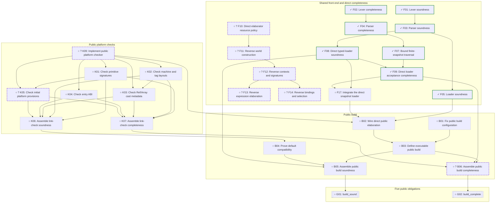
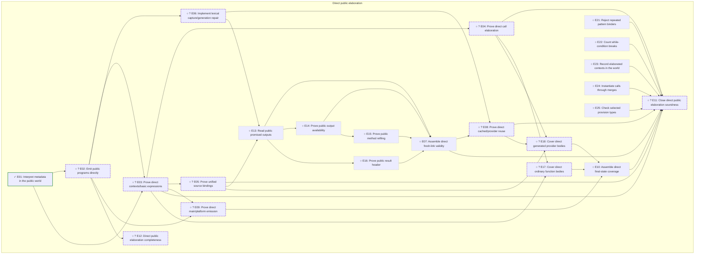

# Executable build and run

[Milestone overview and roadmap policy](../PROOFS.md). [Other branch](safety.md).

Generated from [one canonical task plan](../proof-plan.json). Task IDs and finish conditions are shared across views.

[Loading, platform checking and build](#loading-platform-checking-and-build) · [Direct public elaboration](#direct-public-elaboration) · [Runtime lowering, host and executable agreement](#runtime-lowering-host-and-executable-agreement)

[Task records](#task-records) · [Checkpoint history](#checkpoint-changes)

Ready tasks with tentative hour estimates: [B01](#b01), [F17](#f17), [E21](#e21), [E22](#e22), [E23](#e23), [E24](#e24), [E25](#e25).

Ready tasks needing decomposition: [F10](#f10), [E02](#e02), [L01](#l01), [K09](#k09).

## Loading, platform checking and build

Arrows show prerequisites within this diagram. Completed helper refinements
are folded into the catalog; other diagrams' prerequisites are linked below.

| Task in this diagram | Prerequisite outside the diagram |
| --- | --- |
| [B01](#b01) | [A02](#a02) |
| [B02](#b02) | [E02](#e02) |
| [B04](#b04) | [H07](#h07) |
| [B05](#b05) | [E11](#e11) |
| [B06](#b06) | [E12](#e12) |
| [B06](#b06) | [F18](#f18) |
| [F07](#f07) | [A02](#a02) |
| [F08](#f08) | [A02](#a02) |
| [F10](#f10) | [A02](#a02) |
| [F11](#f11) | [S01](#s01) |
| [F11](#f11) | [E01](#e01) |
| [F12](#f12) | [E01](#e01) |
| [F13](#f13) | [E02](#e02) |
| [F14](#f14) | [E06](#e06) |
| [K01](#k01) | [E01](#e01) |
| [K02](#k02) | [E01](#e01) |
| [K04](#k04) | [E01](#e01) |
| [K05](#k05) | [E02](#e02) |
| [K06](#k06) | [E02](#e02) |
| [K09](#k09) | [A02](#a02) |
| [K09](#k09) | [E01](#e01) |

## Direct public elaboration

Arrows show prerequisites within this diagram. Completed helper refinements
are folded into the catalog; other diagrams' prerequisites are linked below.

| Task in this diagram | Prerequisite outside the diagram |
| --- | --- |
| [E01](#e01) | [S01](#s01) |
| [E01](#e01) | [A03](#a03) |
| [E01](#e01) | [E19](#e19) |
| [E01](#e01) | [E20](#e20) |
| [E02](#e02) | [A03](#a03) |
| [E03](#e03) | [S02](#s02) |
| [E06](#e06) | [S06](#s06) |
| [E06](#e06) | [S07](#s07) |
| [E06](#e06) | [S08](#s08) |
| [E06](#e06) | [S09](#s09) |
| [E06](#e06) | [S10](#s10) |
| [E06](#e06) | [T26](safety.md#t26) |
| [E08](#e08) | [S04](#s04) |
| [E08](#e08) | [S05](#s05) |
| [E12](#e12) | [F10](#f10) |
| [E12](#e12) | [F11](#f11) |
| [E12](#e12) | [F12](#f12) |
| [E12](#e12) | [F13](#f13) |
| [E12](#e12) | [F14](#f14) |
| [E13](#e13) | [S03](#s03) |
| [E17](#e17) | [S29](#s29) |

## Runtime lowering, host and executable agreement

```mermaid
flowchart TB
  subgraph L_group["Selected runtime lowering"]
    L01["○ ? L01: Specify selected runtime lowering"]:::unknown
    L02["○ ? L02: Compile public expressions/bindings"]:::unknown
    L03["○ ? L03: Define fast environment invariant"]:::unknown
    L04["○ L04: Prove fast environment operations"]:::open
    L05["○ ? L05: Prove callable captures/exports"]:::unknown
    L06["○ ? L06: Relate runtime values/cast metadata"]:::unknown
    L07["○ ? L07: Prove supplied-interface adapter"]:::unknown
  end
  subgraph H_group["Default host"]
    H01["○ ? H01: Choose public host adapter"]:::unknown
    H02["○ H02: Numeric/structural primitive laws"]:::open
    H03["○ H03: Memory and I/O primitive laws"]:::open
    H04["○ ? H04: Relate concrete heap states"]:::unknown
    H05["○ H05: Public heap empty/weakening laws"]:::open
    H06["○ ? H06: Public GC/cast heap laws"]:::unknown
    H07["○ H07: Assemble default-interface laws"]:::open
  end
  subgraph X_group["Common-target executable agreement"]
    X01["✓ X01: Exact internal closure agreement"]:::done
    X02["✓ X02: Conditional optimized agreement"]:::done
    X03["○ ? X03: Choose interface-parametric engine"]:::unknown
    X04["○ X04: Simulate basic expression steps"]:::open
    X05["○ X05: Simulate calls and captures"]:::open
    X06["○ ? X06: Simulate functor binding steps"]:::unknown
    X07["○ ? X07: Simulate interface/state operations"]:::unknown
    X08["○ X08: Relate observations and results"]:::open
    X09["○ ? X09: Forward finite-fuel adequacy"]:::unknown
    X10["○ ? X10: Reverse finite-fuel adequacy"]:::unknown
    X11["○ ? X11: Discharge compiled-table preparation"]:::unknown
    X12["○ X12: Implement public run wrapper"]:::open
    X13["○ ? X13: Verify retained optional transformations"]:::unknown
    X14["○ ? X14: Validate integrated one-hour bootstrap"]:::unknown
  end
  subgraph G_group["Five public obligations"]
    G03[["○ G03: run_sound"]]:::open
    G04[["○ G04: run_complete"]]:::open
  end
  H01 --> H02
  H01 --> H03
  H01 --> H04
  H01 --> X14
  H02 --> H07
  H03 --> H07
  H04 --> H05
  H04 --> H06
  H05 --> H07
  H06 --> H07
  L01 --> L02
  L01 --> L03
  L01 --> L06
  L01 --> X03
  L02 --> L05
  L02 --> X04
  L02 --> X11
  L02 --> X12
  L03 --> L04
  L04 --> L05
  L04 --> X04
  L05 --> X05
  L05 --> X06
  L06 --> H01
  L06 --> H02
  L06 --> H03
  L06 --> H06
  L06 --> L07
  L06 --> X08
  L07 --> X07
  X01 --> L01
  X01 --> X11
  X02 --> X13
  X03 --> L07
  X03 --> X04
  X03 --> X05
  X03 --> X06
  X03 --> X12
  X04 --> X08
  X05 --> X08
  X06 --> X08
  X07 --> X08
  X08 --> X09
  X08 --> X10
  X09 --> G03
  X10 --> G04
  X11 --> X12
  X12 --> G03
  X12 --> G04
  X12 --> X14
  X13 --> X09
  X13 --> X10
  X14 --> G03
  X14 --> G04
  click G03 "#g03"
  click G04 "#g04"
  click H01 "#h01"
  click H02 "#h02"
  click H03 "#h03"
  click H04 "#h04"
  click H05 "#h05"
  click H06 "#h06"
  click H07 "#h07"
  click L01 "#l01"
  click L02 "#l02"
  click L03 "#l03"
  click L04 "#l04"
  click L05 "#l05"
  click L06 "#l06"
  click L07 "#l07"
  click X01 "#x01"
  click X02 "#x02"
  click X03 "#x03"
  click X04 "#x04"
  click X05 "#x05"
  click X06 "#x06"
  click X07 "#x07"
  click X08 "#x08"
  click X09 "#x09"
  click X10 "#x10"
  click X11 "#x11"
  click X12 "#x12"
  click X13 "#x13"
  click X14 "#x14"
  classDef done stroke:#238636,stroke-width:2px
  classDef partial stroke:#b8860b,stroke-width:2px,stroke-dasharray:5 3
  classDef open stroke:#888,stroke-dasharray:2 3
  classDef unknown stroke:#8250df,stroke-width:2px,stroke-dasharray:7 3
```

Arrows show prerequisites within this diagram. Completed helper refinements
are folded into the catalog; other diagrams' prerequisites are linked below.

| Task in this diagram | Prerequisite outside the diagram |
| --- | --- |
| [H01](#h01) | [A07](#a07) |
| [L01](#l01) | [A07](#a07) |
| [X03](#x03) | [A07](#a07) |
| [X13](#x13) | [A07](#a07) |
| [X13](#x13) | [T20](safety.md#t20) |
| [X14](#x14) | [A07](#a07) |
| [X14](#x14) | [B03](#b03) |

## Scope and unresolved decisions

The finite source snapshot and exact read/domain facts are implemented;
see [SourceSnapshot.v](../theories/SourceSnapshot.v) and the A01/A02 evidence.
F10 must still justify elaborator recursion/budgets: finite files alone do not
prove elaboration completeness. No arbitrary fixed bound is silently added to Builds.

A03/A07 settle the exact common-target/lowering boundary with evidence. The
direction is chosen, but the port and its universal proofs remain open.
The retained engine must implement the supplied compatible interface. Public
examples and a passing prototype do not prove compiler or elaborator correctness.

X13 covers only the optional transformations actually selected by measurement.
Omitted passes need no port. Any retained fuel/stuck exceptions must be discharged
using T20 or stronger exact agreement, rather than ignored. G05 is independent
of executable emission, runtime lowering, host implementation and performance measurements.

Executable safety follows from semantic safety, build soundness and run soundness.
Neither completeness theorem is needed for that corollary. Build completeness
only promises some output, so it cannot lift an implementation-only safety
result to every declarative program.

Existing internal component proofs retain their exact statements and premises.
They are reusable evidence/reference material for direct ports, not automatic
proofs about public programs. Completing the old internal whole-elaboration
theorem, a whole-program two-model back-translation, and the staged candidate
in [ReifyProgram.v](../theories/ReifyProgram.v) are not required intermediate milestones
in this plan. Certificate-producing elaboration is also deferred.

## Task records

Each finish condition and its evidence has one home. Prerequisites link
to that record, including across diagrams and pages.

### Architecture and performance gates

| Task | Status / budget | Finish condition | Prerequisites | Strategy and evidence |
| --- | --- | --- | --- | --- |
|  **A01** Specify finite-source contract | ✓ done; Proved / defined | Specify an explicit finite source snapshot, canonical path lookup and the intended Builds/build signatures, including how the executable receives its finite inventory. | None | Retain the five public obligations and intended finite-filesystem meaning. Record the exact proposed type/loader changes before implementing them. Retain the five public obligations and intended finite-filesystem meaning. Record the exact proposed type/loader changes before implementing them. [PUBLIC-FOUNDATION.md](../PUBLIC-FOUNDATION.md), [Audit.v](../theories/Audit.v) [PUBLIC-FOUNDATION.md](../PUBLIC-FOUNDATION.md), [Audit.v](../theories/Audit.v) |
|  **A02** Implement finite-source lookup | ✓ done; Proved / defined | Implement the selected source representation and read adapter; establish lookup, uniqueness and finite-inventory facts without silently imposing arbitrary fuel caps. | [A01](#a01) | Keep ordinary lexing/parsing shared. Split source constructors, path handling and loader adapter proofs after A01 fixes their statements. Named result: `source_read_iff`.  [SourceSnapshot.v](../theories/SourceSnapshot.v), [AuditBuildExample.v](../theories/AuditBuildExample.v) |
|  **A03** Prototype common semantic target | ✓ done; Proved / defined | Produce a precise direct-Audit elaborator target and runtime-lowering boundary, with a checked representative operation and capture/output-generation/GC-cast behavior evidence. | [P01](#p01) | The proposal, direct type emitter and partial public closure compiler are implemented. The closed capture/output/cast fixture discharges its table premise. Full language emission, recursive tables, fast caches and production integration remain separate tasks. Named result: `all_fuel_agreement`.  [PUBLIC-FOUNDATION.md](../PUBLIC-FOUNDATION.md), [PublicEmit.v](../theories/PublicEmit.v), [PublicClosurePrototype.v](../theories/PublicClosurePrototype.v), [PublicClosureExample.v](../theories/PublicClosureExample.v) |
|  **A04** Measure current bootstrap baseline | ✓ done; Proved / defined | Record source/executable hashes, elapsed time and compiler fixpoint for the current production pipeline on the local x86 VM, or a measured timeout/failure. | None | The pinned current production pipeline passed the complete compiler fixpoint in 2287.697 seconds. The frozen oracle is byte-identical to the newly checked build; see the checkpoint record and raw benchmark outputs. The pinned current production pipeline passed the complete compiler fixpoint in 2287.697 seconds. The frozen oracle is byte-identical to the newly checked build; see the checkpoint record and raw benchmark outputs. [benchmark-configs.py](../benchmark-configs.py), [foundation-2026-11-08.json](../benchmarks/foundation-2026-11-08.json), [PUBLIC-FOUNDATION.md](../PUBLIC-FOUNDATION.md) [benchmark-configs.py](../benchmark-configs.py), [foundation-2026-11-08.json](../benchmarks/foundation-2026-11-08.json), [PUBLIC-FOUNDATION.md](../PUBLIC-FOUNDATION.md) |
|  **A05** Set up engine configuration comparison | ✓ done; Proved / defined | Specify reproducible comparisons of the closure engine with optional fast-path/pruning passes enabled or disabled, including common inputs and expected results. | [X01](#x01), [X02](#x02) | Use MOSS_FASTPATH/MOSS_PRUNE controls; distinguish exact closure agreement from outer optimization exceptions. Prepare capped background runs. Use MOSS_FASTPATH/MOSS_PRUNE controls; distinguish exact closure agreement from outer optimization exceptions. Prepare capped background runs. [benchmark-configs.py](../benchmark-configs.py), [moss_m2.ml](../ocaml/moss_m2.ml), [LazyCloFacts.v](../theories/LazyCloFacts.v) [benchmark-configs.py](../benchmark-configs.py), [moss_m2.ml](../ocaml/moss_m2.ml), [LazyCloFacts.v](../theories/LazyCloFacts.v) |
|  **A06** Measure candidate engine configurations | ✓ done; Proved / defined | Collect timed fixpoint/regression results, or explicit capped failures, for the candidate production configurations. | [A05](#a05) | Measured all four configurations against one frozen input/oracle: default passed in 2287.697 seconds; each reduced configuration timed out at one hour during S1 generation. Timed-out configurations are not eligible passing pipelines. Measured all four configurations against one frozen input/oracle: default passed in 2287.697 seconds; each reduced configuration timed out at one hour during S1 generation. Timed-out configurations are not eligible passing pipelines. [benchmark-configs.py](../benchmark-configs.py), [foundation-2026-11-08.json](../benchmarks/foundation-2026-11-08.json) [benchmark-configs.py](../benchmark-configs.py), [foundation-2026-11-08.json](../benchmarks/foundation-2026-11-08.json) |
|  **A07** Choose measured implementation boundary | ✓ done; Proved / defined | Choose the common public program target, exact lowering/closure boundary and required optimization passes using prototype and performance evidence. | [A03](#a03), [A04](#a04), [A06](#a06) | Select direct public program emission and local closure/environment lowering. Retain lazy closures and both optional transformations for the initial port because reduced configurations missed the cap. Actual port correctness, concrete lowered invariants and integrated X14 performance remain open. Select direct public program emission and local closure/environment lowering. Retain lazy closures and both optional transformations for the initial port because reduced configurations missed the cap. Actual port correctness, concrete lowered invariants and integrated X14 performance remain open. [PUBLIC-FOUNDATION.md](../PUBLIC-FOUNDATION.md), [foundation-2026-11-08.json](../benchmarks/foundation-2026-11-08.json), [PublicClosurePrototype.v](../theories/PublicClosurePrototype.v) [PUBLIC-FOUNDATION.md](../PUBLIC-FOUNDATION.md), [foundation-2026-11-08.json](../benchmarks/foundation-2026-11-08.json), [PublicClosurePrototype.v](../theories/PublicClosurePrototype.v) |

### Shared front end and direct completeness

| Task | Status / budget | Finish condition | Prerequisites | Strategy and evidence |
| --- | --- | --- | --- | --- |
|  **F01** Lexer soundness | ✓ done; Proved / defined | Successful lexing implies Lexes. | None | Existing proof. Named result: `lex_sound`.  [FrontEnd.v](../theories/FrontEnd.v) |
|  **F02** Lexer completeness | ✓ done; Proved / defined | Lexes implies successful lexing of the specified tokens. | None | Existing proof. Named result: `lex_complete`.  [FrontEnd.v](../theories/FrontEnd.v) |
|  **F03** Parser soundness | ✓ done; Proved / defined | Successful parsing implies Derives. | [F01](#f01) | Existing proof. Named result: `parse_moss_sound`.  [FrontEnd.v](../theories/FrontEnd.v) |
|  **F04** Parser completeness | ✓ done; Proved / defined | Derives implies successful parsing. | [F02](#f02) | Existing proof. Named result: `parse_moss_complete`.  [FrontEndComplete.v](../theories/FrontEndComplete.v) |
|  **F05** Loader soundness | ✓ done; Proved / defined | Successful load implies Loader.Bundled. | [F03](#f03) | Existing proof; no completeness claim. Named result: `load_sound`.  [FrontEndLoader.v](../theories/FrontEndLoader.v) |
|  **F07** Bound finite-snapshot traversal | ✓ done; Proved / defined | A worklist potential decreases even for repeated pops, and the input-derived snapshot_fuel suffices for every closed readable witness reachable from the entry. | [A02](#a02), [F04](#f04) | Count unseen registered paths weighted by maximum import/prelude degree, plus outstanding pops. Unused invalid files are not rejected. Named result: `walk_accepts_closed_witness`.  [SnapshotLoaderBound.v](../theories/SnapshotLoaderBound.v), [SnapshotLoader.v](../theories/SnapshotLoader.v) |
|  **F08** Direct typed-loader soundness | ✓ done; Proved / defined | The direct typed-AST loader returns only Bundled outputs with unique module paths and complete import/prelude closure. | [A02](#a02), [F03](#f03) | Prove a worklist invariant and parser soundness; use canonical public paths. No dump/read conversion or dump-name restriction is present. Named result: `load_sound`.  [SnapshotLoader.v](../theories/SnapshotLoader.v) |
|  **F09** Direct loader acceptance completeness | ✓ done; Proved / defined | Any Bundled witness for the finite source guarantees successful direct loading at the computed fuel bound. | [F07](#f07), [F08](#f08) | Combine witness closure and parser completeness with the decreasing potential. Output is existential: the witness may contain irrelevant extra modules. CLI integration and transport to the actually loaded bundle are separate obligations. Named result: `load_complete`.  [SnapshotLoader.v](../theories/SnapshotLoader.v) |
|  **F10** Direct elaborator resource policy | ○ open; ? Decompose | Replace or justify declaration/type/elaboration budgets for all public-buildable finite-source inputs. | [A02](#a02) | Audit recursion in the direct public elaborator and derive bounds or terminating algorithms. A finite file list alone does not establish elaborator completeness.  [Elab.v](../theories/Elab.v) |
|  **F11** Reverse world construction | ○ open; ? Decompose | Construct an executable world/metadata reading from a public declarative world, up to the fresh names allowed by build completeness. | [F10](#f10), [S01](#s01), [E01](#e01) | Invert public WorldOf using the direct metadata interpretation; split scope, shadowing and requirement cases.  [WorldSound.v](../theories/WorldSound.v), [ReqsTotal.v](../theories/ReqsTotal.v) |
|  **F12** Reverse contexts and signatures | ○ open; ? Decompose | Public declarative contexts, signatures and type readings are accepted by the direct executable elaborator. | [F11](#f11), [E01](#e01) | Prove the backward directions of the direct public context/checking operations; no whole-program model back-translation.  [CtxWalk.v](../theories/CtxWalk.v), [ProviderSig.v](../theories/ProviderSig.v), [ComponentContracts.v](../theories/ComponentContracts.v) |
|  **F13** Reverse expression elaboration | ○ open; ? Decompose | Public expression derivations admit successful direct executable elaboration, with the chosen fresh symbols. | [F12](#f12), [E02](#e02) | Separate source expression constructors and expected-type checking once the direct context invariant is fixed.  [Elab.v](../theories/Elab.v), [Audit.v](../theories/Audit.v) |
|  **F14** Reverse bindings and selection | ○ open; ? Decompose | Public binding/provider/family derivations yield successful direct executable checks with coherent captures and fresh outputs. | [F12](#f12), [E06](#e06) | Split unified binding forms, selection and recursive demand against the public rules.  [Elab.v](../theories/Elab.v), [ComponentContracts.v](../theories/ComponentContracts.v) |
|  **F17** Integrate the direct snapshot loader | ○ open; ≤1h, tentative | The selected build/CLI path uses the verified direct typed loader and finite source inventory. | [F08](#f08), [F09](#f09) | Replace the legacy bundle codec path at the public build boundary, preserving the snapshot input contract and diagnostics. Origin: refinement under [B02](#b02).  [SnapshotLoader.v](../theories/SnapshotLoader.v), [moss_m2.ml](../ocaml/moss_m2.ml) |
|  **F18** Transport reachable bundle witnesses | ✓ done; Proved / defined | Relate the declarative build witness to the actual reachable bundle returned by the direct loader. | [F09](#f09) | Prove any two Bundled witnesses for the same source agree on reachable modules. Transport WorldOf and Elaborates to the actual direct-loader output, preserving the same world and program. Origin: refinement under [B06](#b06). Named result: `load_elaborates_complete`.  [SnapshotLoaderWitness.v](../theories/SnapshotLoaderWitness.v) |

### Reusable internal source components

| Task | Status / budget | Finish condition | Prerequisites | Strategy and evidence |
| --- | --- | --- | --- | --- |
|  **S01** Source-world reading | ✓ done; Proved / defined | Successful internal elaboration constructs a correct source world and requirement reading. | None | Existing proof; field-number injection remains explicit. Named result: `elaborate_world_of`.  [ReqsTotal.v](../theories/ReqsTotal.v) |
|  **S02** Conditional body dispatcher | ✓ done; Proved / defined | Pending follows from the existing construct lemmas assuming Hnonmethod_remainingbind and the section world hypotheses. | None | Existing conditional internal proof. Reuse its construct lemmas in E03; E11 closes the direct public port's remaining callbacks. Named result: `pending`.  [BodyPending.v](../theories/BodyPending.v) |
|  **S03** Conditional fresh-link receipts | ✓ done; Proved / defined | Fresh execution supplies context, capture, body and allocation receipts under OneStep, invariants and final-state premises. | None | Existing conditional proof; excludes the output certificate. Named result: `link_body_fresh_data`.  [LinkBodySound.v](../theories/LinkBodySound.v) |
|  **S04** Link-creator provenance | ✓ done; Proved / defined | Actual whole-program execution preserves authenticated cached-link creators. | None | Existing provenance proof, not semantic validity. Named result: `elab_init_link_inv`.  [LinkProgramPreserve.v](../theories/LinkProgramPreserve.v) |
|  **S05** Final functor rows | ✓ done; Proved / defined | Actual final and historical functor rows agree with the program tables. | None | Existing proof. Named result: `elab_program_final_links`.  [FunctorRowsProgram.v](../theories/FunctorRowsProgram.v) |
|  **S06** Private snapshot readings | ✓ done; Proved / defined | Scoped types retain their semantic lookup under the stated snapshot assumptions. | None | Existing helper proof; not actual link_body integration. Named result: `scoped_type_read`.  [InputGenerationScope.v](../theories/InputGenerationScope.v) |
|  **S07** Private scope allocation | ✓ done; Proved / defined | A finite private generation scope is connected to actual fresh symbol allocations. | None | Existing allocation helpers. Named result: `reserved_link_input_plan`.  [InputGenerationAllocate.v](../theories/InputGenerationAllocate.v) |
|  **S08** Private merge action | ✓ done; Proved / defined | Private snapshots preserve the source merge action under their explicit scope assumptions. | None | Existing merge helpers. Named result: `private_canon_read`.  [InputGenerationMerge.v](../theories/InputGenerationMerge.v) |
|  **S09** Private capture preservation | ✓ done; Proved / defined | Captured private meanings survive caller rebinding under the explicit transfer assumptions. | None | Existing helper theorem. Named result: `private_capture_grounding_survives_caller_rebinding`.  [InputGenerationRuntime.v](../theories/InputGenerationRuntime.v) |
|  **S10** Runtime result export meanings | ✓ done; Proved / defined | Result transfers install the exported type meaning at the caller generation. | None | Existing runtime repair and lookup/grounding proof. Named result: `frame_result_private_grounding`.  [InputGenerationExports.v](../theories/InputGenerationExports.v) |
|  **S29** Conditional function assembly | ✓ done; Proved / defined | Completed function traces yield FnElab under Pending, Later and final body agreement. | None | Existing conditional proof. Named result: `completed_history_fn_elab`.  [FnElabExec.v](../theories/FnElabExec.v) |

### Existing representation groundwork

| Task | Status / budget | Finish condition | Prerequisites | Strategy and evidence |
| --- | --- | --- | --- | --- |
|  **P01** Type/value representation definitions | ✓ done; Proved / defined | Explicit type_represents and value_represents relations exist. | None | Definitions only; this done node claims no totality, simulation or whole-program correspondence. Named result: `value_represents`.  [AuditRepresentation.v](../theories/AuditRepresentation.v) |

### Direct public elaboration

| Task | Status / budget | Finish condition | Prerequisites | Strategy and evidence |
| --- | --- | --- | --- | --- |
|  **E01** Interpret metadata in the public world | ✓ done; Proved / defined | Accepted executable elaboration supplies the public WorldOf reading of loaded metadata and its exact requirement lists. | [S01](#s01), [A03](#a03), [E19](#e19), [E20](#e20) | Transport shared syntactic requirement predicates, extract raw ReqsReading, and combine with exact declarations/scopes/exports/attached/library facts. No field numbering or whole-program refinement is required; public context/code formation remains separate. Named result: `elaborate_public_world_of`.  [PublicWorld.v](../theories/PublicWorld.v), [PublicWorldScope.v](../theories/PublicWorldScope.v), [PublicWorldRequirements.v](../theories/PublicWorldRequirements.v) |
|  **E02** Emit public programs directly | ○ open; ? Decompose | Make executable elaboration emit Audit programs, expressions and unified bindings, retaining implementation metadata needed for checks. | [A03](#a03), [E01](#e01) | Port emission by constructor, starting with the prototype. Preserve CLI/tests while keeping the semantic target fixed.  [Audit.v](../theories/Audit.v), [Elab.v](../theories/Elab.v) |
|  **E03** Prove direct contexts/basic expressions | ○ open; ? Decompose | Successful direct context/basic-expression operations implement the public elaboration rules, with explicit smaller-fuel hypotheses for recursive cases. | [E02](#e02), [E01](#e01), [S02](#s02) | Port reusable component lemmas; decompose by source constructor. E11 must discharge all project callbacks in the global induction.  [Audit.v](../theories/Audit.v), [BodyPending.v](../theories/BodyPending.v) |
|  **E04** Prove direct call elaboration | ○ open; ? Decompose | Ordinary, method and family calls emitted by the executable satisfy the corresponding public judgments. | [E03](#e03) | Port call lookup, satisfaction maps and demand cases directly to Audit; keep induction hypotheses explicit.  [Audit.v](../theories/Audit.v), [CallDefinedAny.v](../theories/CallDefinedAny.v) |
|  **E05** Prove unified source bindings | ○ open; ? Decompose | Successful ordinary/provider bindings implement the public unified binding judgments under explicit recursive hypotheses. | [E03](#e03) | Split value/type/method/lambda/functor cases. Capture/output cases are supplied by E06-E08.  [Audit.v](../theories/Audit.v), [BindMethodExec.v](../theories/BindMethodExec.v) |
|  **E06** Implement lexical capture/generation repair | ○ open; ? Decompose | Actual public-target elaboration preserves lexical captures, fixed inputs and fresh outputs, including the known merged-input/output case. | [E02](#e02), [S06](#s06), [S07](#s07), [S08](#s08), [S09](#s09), [S10](#s10), [T26](safety.md#t26) | Reuse private-generation preparations and the separate result-transfer repair. Integrate only what the direct public rules require; prove concrete receipts.  [Audit.v](../theories/Audit.v), [Elab.v](../theories/Elab.v), [functor_input_output_generations.moss](../../tests/regressions/functor_input_output_generations.moss) |
|  **E13** Read public promised outputs | ○ open; ≤1h, tentative | Actual fresh-link execution supplies the public promised-result reading at the target inputs and fresh output generations. | [E05](#e05), [E06](#e06), [S03](#s03) | Adapt the existing output-reading lemmas directly to the selected public emission invariant.  [Audit.v](../theories/Audit.v), [LinkOutputProvide.v](../theories/LinkOutputProvide.v) |
|  **E14** Prove public output availability | ○ open; ≤1h, tentative | Every promised fresh-link key is provided at its correct post-body meaning. | [E13](#e13) | Port checked output-presence reasoning and discharge its concrete key-reading premises.  [Audit.v](../theories/Audit.v), [LinkOutputPresence.v](../theories/LinkOutputPresence.v) |
|  **E15** Prove public method refiling | ○ open; ≤1h, tentative | Actual method aliases/refiling match the public renamed promised output keys. | [E14](#e14) | Use the fixed public generation reading to prove the alias equality.  [Audit.v](../theories/Audit.v), [LinkOutputRefile.v](../theories/LinkOutputRefile.v) |
|  **E16** Prove public result header | ○ open; ≤1h, tentative | The emitted public result telescope agrees with declared outputs under the chosen fresh generations. | [E13](#e13) | Port allocation/index/header reasoning without adding a whole-program representation layer.  [Audit.v](../theories/Audit.v), [LinkOutputIndex.v](../theories/LinkOutputIndex.v) |
|  **E07** Assemble direct fresh-link validity | ○ open; ≤1h, tentative | Actual fresh-linked code satisfies public LinkBody, retaining only the ordinary induction/invariant premises. | [E13](#e13), [E14](#e14), [E15](#e15), [E16](#e16) | Assemble promised reading, availability, aliases and emitted header.  [Audit.v](../theories/Audit.v), [LinkBodySound.v](../theories/LinkBodySound.v) |
|  **E08** Prove direct cached/provider reuse | ○ open; ? Decompose | Reusing cached generated bodies preserves the public link/provider judgments and their lexical generation readings. | [E07](#e07), [E06](#e06), [S04](#s04), [S05](#s05) | Reuse authenticated creator/final-row facts where applicable; prove semantic validity directly in the public model.  [Audit.v](../theories/Audit.v), [LinkCacheInvariant.v](../theories/LinkCacheInvariant.v) |
|  **E09** Prove direct main/platform emission | ○ open; ? Decompose | The actual emitted main, initial semantic provisions and Bool reading meet the public elaboration relation. | [E02](#e02), [E03](#e03) | Adapt actual main/frame/Bool receipts to public program fields; keep executable platform checking separate.  [Audit.v](../theories/Audit.v), [MainProgramTrace.v](../theories/MainProgramTrace.v), [MainProgramBool.v](../theories/MainProgramBool.v) |
|  **E17** Cover direct ordinary function bodies | ○ open; ? Decompose | Every defined source function has a public function-elaboration receipt in the final program, under explicit global induction premises. | [E03](#e03), [E04](#e04), [S29](#s29) | Port completed-body coverage and final lookup transport; keep final-state obligations visible.  [Audit.v](../theories/Audit.v), [FnCompleted.v](../theories/FnCompleted.v), [FnElabExec.v](../theories/FnElabExec.v) |
|  **E18** Cover direct generated provider bodies | ○ open; ? Decompose | Generated lambda, wrapper, forwarder and linked bodies have final public elaboration receipts. | [E04](#e04), [E05](#e05), [E08](#e08) | Inventory emission forms and split their coverage proofs rather than assuming a generated-body callback.  [Audit.v](../theories/Audit.v), [FinalLambdas.v](../theories/FinalLambdas.v), [FinalForwarders.v](../theories/FinalForwarders.v) |
|  **E10** Assemble direct final-state coverage | ○ open; ≤1h, tentative | One final public program/world contains all required source/generated body and initial-environment receipts. | [E17](#e17), [E18](#e18), [E09](#e09) | Assemble coverage and monotonic final-table facts under clearly stated smaller-fuel assumptions.  [Audit.v](../theories/Audit.v), [FunctionFrameProgram.v](../theories/FunctionFrameProgram.v) |
|  **E11** Close direct public elaboration soundness | ○ open; ? Decompose | Every successful direct executable elaboration satisfies public ElaboratesIn with no unresolved project callbacks. | [E03](#e03), [E04](#e04), [E05](#e05), [E07](#e07), [E08](#e08), [E10](#e10), [E21](#e21), [E22](#e22), [E23](#e23), [E24](#e24), [E25](#e25) | Close the mutual fuel/final-state induction. Do not first complete internal elaborate_sound and then prove a second source-model refinement.  [Audit.v](../theories/Audit.v), [Elab.v](../theories/Elab.v) |
|  **E12** Direct public elaboration completeness | ○ open; ? Decompose | Every public-buildable bundle is accepted by direct elaboration, with the implementation fresh names permitted by the public contract. | [F10](#f10), [F11](#f11), [F12](#f12), [F13](#f13), [F14](#f14), [E02](#e02) | Assemble backward rule proofs and justified resource bounds, including the direct entry environment.  [Audit.v](../theories/Audit.v), [Elab.v](../theories/Elab.v) |
|  **E19** Emit public type metadata | ✓ done; Proved / defined | Direct type emission preserves structural field names and commutes with the existing input-bounded executable type substitution. | None | Verified emit_type and emit_full_substitution. This does not establish context meaning, machine initialization or whole elaboration soundness. Origin: refinement under [E02](#e02). Named result: `emit_full_substitution`.  [PublicEmit.v](../theories/PublicEmit.v) |
|  **E20** Read public declaration and scope metadata | ✓ done; Proved / defined | Read actual loaded metadata into public worlds, with declaration provenance/completeness, exact exports/scopes/attached methods and acyclic imports. | None | Reuse shared source predicates, without field numbering or whole elaboration refinement. The conditional WorldOf assembler explicitly retains all six public requirements premises. Origin: refinement under [E01](#e01). Named result: `load_world_world_of_from_requirements`.  [PublicWorld.v](../theories/PublicWorld.v), [PublicWorldScope.v](../theories/PublicWorldScope.v) |
|  **E21** Reject repeated pattern binders | ○ open; ≤1h, tentative | The executable elaborators (Elab.v and src/) reject a record pattern that binds a name twice, as Audit's PRecord now requires, with a tests/errors case. | None | Add the distinctness check to both pattern elaborators and the agreement corpus; until then such programs are accepted by the implementation but not by Builds. Origin: discovery under [E11](#e11).  [Audit.v](../theories/Audit.v), [Elab.v](../theories/Elab.v), [duplicate-field-binder.moss](../examples/duplicate-field-binder.moss) |
|  **E22** Count while-condition breaks | ○ open; ≤1h, tentative | The executable elaborators (Elab.v and src/) treat a break in a while condition as leaving the enclosing loop, as Audit's StmtBreaks now does, with a regression test. | None | Extend has_break_s (Elab.v) and the self-hosted equivalent; until then `loop { while break {} }` is accepted at type never by the implementation but not by Builds. Origin: discovery under [E11](#e11).  [Audit.v](../theories/Audit.v), [Elab.v](../theories/Elab.v), [while-condition-break.moss](../examples/while-condition-break.moss) |
|  **E23** Record elaborated contexts in the world | ○ open; ≤1h, tentative | The public world read from an executable elaboration records, in w_context, the context and needs the elaborator formed for each fn, method and functor symbol, so every CtxOf and FunCtx use agrees with it. | None | PublicWorld.world_of currently records no contexts; supply the elaborator's per-symbol contexts (fn_info and functor readings) and prove they satisfy the remaining CtxOf/FunCtx conditions. Origin: discovery under [E11](#e11).  [Audit.v](../theories/Audit.v), [PublicWorld.v](../theories/PublicWorld.v) |
|  **E24** Instantiate calls through merges | ○ open; ≤1h, tentative | The executable elaborators (Elab.v and src/) choose each call's and provider's instantiation so that it satisfies CallTheta: caller meanings where bound and every callee merge, rejecting calls that bind one merged class inconsistently, with regression tests. | None | Read unbound members of a merged class through a bound member; reject when no such instantiation exists. bootstrap/examples/unbound-merge-representative.moss must be rejected and partially-bound-merge.moss accepted. Origin: discovery under [E11](#e11).  [Audit.v](../theories/Audit.v), [Elab.v](../theories/Elab.v), [unbound-merge-representative.moss](../examples/unbound-merge-representative.moss), [partially-bound-merge.moss](../examples/partially-bound-merge.moss) |
|  **E25** Check selected provision types | ○ open; ≤1h, tentative | The executable elaborators (Elab.v and src/) reject a call or functor application whose selected provision's type or signature differs from the callee's view read at the instantiation, as Audit's Satisfies now requires, with a regression test. | None | Compare the caller's canonical provision signature with the callee's entry signature substituted by θ. bootstrap/examples/stale-provision-type.moss must be rejected. Origin: discovery under [E11](#e11).  [Audit.v](../theories/Audit.v), [Elab.v](../theories/Elab.v), [stale-provision-type.moss](../examples/stale-provision-type.moss) |

### Selected runtime lowering

| Task | Status / budget | Finish condition | Prerequisites | Strategy and evidence |
| --- | --- | --- | --- | --- |
|  **L01** Specify selected runtime lowering | ○ open; ? Decompose | Fix the closure/lowering relation from public runtime code to the selected fast representation, including all valid-domain premises. | [A07](#a07), [X01](#x01) | Keep a single semantic language. Any numeric IDs/maps/caches are local implementation choices with explicit correspondence lemmas.  [Audit.v](../theories/Audit.v), [LazyCloFacts.v](../theories/LazyCloFacts.v) |
|  **L02** Compile public expressions/bindings | ○ open; ? Decompose | Implement selected closure compilation directly from public expressions and unified bindings. | [L01](#l01) | Port constructors and callable tables; split nonstructural lowering operations after L01 fixes the representation.  [Audit.v](../theories/Audit.v), [LazyClo.v](../theories/LazyClo.v) |
|  **L03** Define fast environment invariant | ○ open; ? Decompose | Relate fast provision/type/local environments and caches to the public environments without a whole-program model translation. | [L01](#l01) | Specify map lookup, deferred substitutions and captured environments separately.  [Audit.v](../theories/Audit.v), [LazyEnvFacts.v](../theories/LazyEnvFacts.v) |
|  **L04** Prove fast environment operations | ○ open; ≤1h, tentative | Selected lookup, append, instantiation and grounding operations preserve the public environment relation. | [L03](#l03) | Adapt existing map/deferred-substitution lemmas to the selected representation.  [Audit.v](../theories/Audit.v), [LazyEnvFacts.v](../theories/LazyEnvFacts.v) |
|  **L05** Prove callable captures/exports | ○ open; ? Decompose | Compiled closures retain public lexical captures, callable input interfaces and output-generation exports. | [L02](#l02), [L04](#l04) | Split closure creation, call entry and result export; this proof concerns public runtime behavior, independently of executable build success.  [Audit.v](../theories/Audit.v), [LazyCloFacts.v](../theories/LazyCloFacts.v) |
|  **L06** Relate runtime values/cast metadata | ○ open; ? Decompose | Selected value/address/cast encodings preserve public value shapes and metadata lookups, or are proved identity where representations are shared. | [L01](#l01) | Prove only conversions actually retained after A07; split checked-handle and record cases if necessary.  [Audit.v](../theories/Audit.v), [AuditRepresentation.v](../theories/AuditRepresentation.v) |
|  **L07** Prove supplied-interface adapter | ○ open; ? Decompose | The engine adapter invokes the same supplied interface and preserves its values, outcomes and external state. | [L06](#l06), [X03](#x03) | Prove actual call correspondence for arbitrary compatible interfaces; typed signatures alone are insufficient.  [Audit.v](../theories/Audit.v), [DefaultRuntime.v](../theories/DefaultRuntime.v) |

### Public platform checks

| Task | Status / budget | Finish condition | Prerequisites | Strategy and evidence |
| --- | --- | --- | --- | --- |
|  **K01** Check primitive signatures | ○ open; ≤1h, tentative | A source primitive-signature checker agrees with public AtKey/MethodPrimitive conditions for the relevant entries. | [E01](#e01), [K09](#k09) | Prove the checker clauses against the shared source world.  [Audit.v](../theories/Audit.v) |
|  **K02** Check machine and tag layouts | ○ open; ≤1h, tentative | A layout checker agrees with public Layouts, including machine declarations and Bool/tag payload layouts. | [E01](#e01), [K09](#k09) | Handle the finite designated layout cases using E01 lookups.  [Audit.v](../theories/Audit.v) |
|  **K03** Check Ref/Array cast metadata | ○ open; ≤1h, tentative | The cast metadata checker agrees with public Representations. | [K02](#k02), [K09](#k09) | Combine CastEntry cases and exact generated metadata shape.  [Audit.v](../theories/Audit.v) |
|  **K04** Check entry ABI | ○ open; ≤1h, tentative | Executable entry checks agree with EntryPoint, including recursively zero-lane EntryResult cases. | [E01](#e01), [K09](#k09) | Use signature lookup and structural result-layout checking.  [Audit.v](../theories/Audit.v), [EntryShape.v](../theories/EntryShape.v) |
|  **K05** Check initial platform provisions | ○ open; ? Decompose | The initial environment/family checker agrees with public Entry and Family judgments. | [E02](#e02), [K01](#k01), [K09](#k09) | Generated platform-family bindings and provision keys may need further decomposition.  [Audit.v](../theories/Audit.v), [ReifyPlatform.v](../theories/ReifyPlatform.v) |
|  **K06** Assemble link-check soundness | ○ open; ≤1h, tentative | Successful public platform checking implies Linked in the elaboration world. | [K01](#k01), [K02](#k02), [K03](#k03), [K04](#k04), [K05](#k05), [E02](#e02) | Assemble EntryPoint, Layouts, Representations and initial entries.  [Audit.v](../theories/Audit.v) |
|  **K07** Assemble link-check completeness | ○ open; ≤1h, tentative | Linked implies acceptance by the public platform checker under the chosen representation. | [K01](#k01), [K02](#k02), [K03](#k03), [K04](#k04), [K05](#k05) | Compose the backward directions of the component checker equivalences.  [Audit.v](../theories/Audit.v) |
|  **K09** Implement public platform checker | ○ open; ? Decompose | Implement finite checks for public Linked using the same source world as direct elaboration. | [A02](#a02), [E01](#e01) | Keep executable checker construction separate from its soundness/completeness proofs so runtime benchmarking can start early.  [Audit.v](../theories/Audit.v) |

### Default host

| Task | Status / budget | Finish condition | Prerequisites | Strategy and evidence |
| --- | --- | --- | --- | --- |
|  **H01** Choose public host adapter | ○ open; ? Decompose | Define the concrete public host/state adapter used by the fixed default interface. | [A07](#a07), [L06](#l06) | Settle value/address conversion and failure behavior without assuming host laws.  [DefaultRuntime.v](../theories/DefaultRuntime.v), [AuditRepresentation.v](../theories/AuditRepresentation.v) |
|  **H02** Numeric/structural primitive laws | ○ open; ≤1h, tentative | The public default host satisfies typed laws for non-memory numeric, record and tag operations. | [H01](#h01), [L06](#l06) | Transport existing primitive cases through the chosen value relation; split operation groups if transport is not uniform.  [MossX.v](../theories/MossX.v), [DefaultRuntime.v](../theories/DefaultRuntime.v) |
|  **H03** Memory and I/O primitive laws | ○ open; ≤1h, tentative | Default linear-memory, arguments/file and I/O primitives preserve their public signatures and state behavior. | [H01](#h01), [L06](#l06) | Reuse internal primitive laws through the host adapter.  [MossX.v](../theories/MossX.v), [DefaultRuntime.v](../theories/DefaultRuntime.v) |
|  **H04** Relate concrete heap states | ○ open; ? Decompose | Specify/prove the public heap predicate corresponding to the concrete heap, including address and held-type readings. | [H01](#h01) | Separate heap-store representation from primitive stepping; decompose after adapter selection.  [XHeapC.v](../theories/XHeapC.v), [Audit.v](../theories/Audit.v) |
|  **H05** Public heap empty/weakening laws | ○ open; ≤1h, tentative | The public default heap predicate has the required empty-heap and weakening properties. | [H04](#h04) | Transport existing concrete heap_empty and heap_mono.  [XHeapC.v](../theories/XHeapC.v), [DefaultRuntime.v](../theories/DefaultRuntime.v) |
|  **H06** Public GC/cast heap laws | ○ open; ? Decompose | Allocation, dereference, updates and checked casts satisfy public gc_pre/gc_post and heap preservation. | [H04](#h04), [L06](#l06) | Establish held-type predicate conversion; split allocation/read/write/cast if it is not a uniform transport.  [XHeapC.v](../theories/XHeapC.v), [Audit.v](../theories/Audit.v) |
|  **H07** Assemble default-interface laws | ○ open; ≤1h, tentative | The chosen default interface satisfies every public interface_laws conjunct for every program view. | [H02](#h02), [H03](#h03), [H05](#h05), [H06](#h06) | Assemble primitive, unsupported, non-GC and GC laws.  [DefaultRuntime.v](../theories/DefaultRuntime.v), [Audit.v](../theories/Audit.v) |

### Common-target executable agreement

| Task | Status / budget | Finish condition | Prerequisites | Strategy and evidence |
| --- | --- | --- | --- | --- |
|  **X01** Exact internal closure agreement | ✓ done; Proved / defined | Compiled closures equal internal run_main when the table equations hold. | None | Existing theorem with explicit table premise. Named result: `crun_main_eq`.  [LazyCloFacts.v](../theories/LazyCloFacts.v) |
|  **X02** Conditional optimized agreement | ✓ done; Proved / defined | The production pruning/fast/closure path agrees with internal reference execution, allowing its stated fuel/stuck exceptions. | None | Existing bound contract, not agreement with public Runs. Named result: `fast_engine_agrees`.  [LazyOracle.v](../theories/LazyOracle.v), [LazyCloFacts.v](../theories/LazyCloFacts.v) |
|  **X03** Choose interface-parametric engine | ○ open; ? Decompose | Parameterize the selected common-target engine by the actual supplied public interface and state. | [A07](#a07), [L01](#l01) | Implement the interface strategy chosen at A07 while retaining the measured fast closure path; split remaining primitive dispatch/state operations.  [LazyOracle.v](../theories/LazyOracle.v), [Audit.v](../theories/Audit.v) |
|  **X04** Simulate basic expression steps | ○ open; ≤1h, tentative | Public basic-expression execution and its compiled closures correspond under explicit fuel/environment hypotheses. | [X03](#x03), [L02](#l02), [L04](#l04) | Prove structural compiler case lemmas, using the common public syntax rather than translating between complete semantic languages.  [AuditRepresentation.v](../theories/AuditRepresentation.v), [LazyCloFacts.v](../theories/LazyCloFacts.v) |
|  **X05** Simulate calls and captures | ○ open; ≤1h, tentative | Compiled function/method calls preserve public callable and lexical-capture semantics. | [X03](#x03), [L05](#l05) | Use the selected callable/environment invariant for call entry and return.  [AuditRepresentation.v](../theories/AuditRepresentation.v), [LazyCloFacts.v](../theories/LazyCloFacts.v) |
|  **X06** Simulate functor binding steps | ○ open; ? Decompose | Compiled unified binding, functor application and output scopes correspond to public execution. | [X03](#x03), [L05](#l05) | Split closure creation, binding, application and export cases of the chosen compiler.  [AuditRepresentation.v](../theories/AuditRepresentation.v), [LazyCloFacts.v](../theories/LazyCloFacts.v) |
|  **X07** Simulate interface/state operations | ○ open; ? Decompose | Selected primitive/heap operations produce the same observed result and external state as the supplied public interface. | [L07](#l07) | Apply the supplied-interface adapter theorem; retain heap/address conversion obligations only if the selected runtime needs them.  [AuditRepresentation.v](../theories/AuditRepresentation.v), [Audit.v](../theories/Audit.v) |
|  **X08** Relate observations and results | ○ open; ≤1h, tentative | Translated normal/exit/trap/unsupported/wrong signals and states agree with the public observe function. | [L06](#l06), [X04](#x04), [X05](#x05), [X06](#x06), [X07](#x07) | Exhaust the finite signal constructors; keep OutOfFuel as absence of an observation.  [Audit.v](../theories/Audit.v) |
|  **X09** Forward finite-fuel adequacy | ○ open; ? Decompose | Every selected-engine result on an admissible public program has a public Runs derivation. | [X08](#x08), [X13](#x13) | Combine common-target compiler correspondence with verified retained transformations and explicit budget translation.  [AuditRepresentation.v](../theories/AuditRepresentation.v), [LazyOracle.v](../theories/LazyOracle.v) |
|  **X10** Reverse finite-fuel adequacy | ○ open; ? Decompose | Every public Runs derivation for an admissible program is reported by the selected engine at some finite budget. | [X08](#x08), [X13](#x13) | Prove fuel adequacy for the common-target compiler and retained transformations. No reverse encoding into the old program language is required.  [AuditRepresentation.v](../theories/AuditRepresentation.v), [LazyOracle.v](../theories/LazyOracle.v) |
|  **X11** Discharge compiled-table preparation | ○ open; ? Decompose | The actual executable preparation supplies the table equations used by agreement, with the OCaml trust boundary stated precisely. | [X01](#x01), [L02](#l02) | Discharge actual preparation equations for compilation from public programs, resolving the OCaml/extraction boundary explicitly; do not assume Prepared as the final guarantee.  [ComponentContracts.v](../theories/ComponentContracts.v), [moss_m2.ml](../ocaml/moss_m2.ml) |
|  **X12** Implement public run wrapper | ○ open; ≤1h, tentative | Define run on public programs, supplied interfaces, states and observation budgets using the selected executable path. | [X03](#x03), [X11](#x11), [L02](#l02) | Compile the public program directly and connect the selected engine/preparer to observe; no old-model program encoder.  [Audit.v](../theories/Audit.v), [Certified.v](../theories/Certified.v) |
|  **X13** Verify retained optional transformations | ○ open; ? Decompose | The exact retained fast-path/pruning configuration preserves the observations needed by public run soundness and completeness. | [A07](#a07), [X02](#x02), [T20](safety.md#t20) | Omitted passes need no port. For retained passes, adapt existing proofs and discharge fuel/stuck exceptions. If no passes are needed, prove the identity configuration.  [FastPath.v](../theories/FastPath.v), [Prune.v](../theories/Prune.v), [LazyCloFacts.v](../theories/LazyCloFacts.v) |
|  **X14** Validate integrated one-hour bootstrap | ○ open; ? Decompose | The fully integrated selected public-target pipeline bootstraps the pinned compiler to a matching fixpoint within one hour on the local x86 VM. | [A07](#a07), [X12](#x12), [B03](#b03), [H01](#h01) | Record source/executable/configuration hashes and timings. This is a release/performance gate, not a premise added to the logical theorem. Run in the background and investigate a capped failure.  [flake.nix](../../flake.nix), [moss_m2.ml](../ocaml/moss_m2.ml) |

### Public build

| Task | Status / budget | Finish condition | Prerequisites | Strategy and evidence |
| --- | --- | --- | --- | --- |
|  **B01** Fix public build configuration | ○ open; ≤1h, tentative | Fix the intended prelude and canonical finite-source/path configuration for the public build implementation. | [A02](#a02) | Apply the finite-source contract; preserve intended filesystem behavior and explicit error handling.  [Audit.v](../theories/Audit.v) |
|  **B02** Wire direct public elaboration | ○ open; ≤1h, tentative | Implement loading, direct public-program emission and public platform checking as one executable build path. | [F05](#f05), [E02](#e02), [K09](#k09), [F17](#f17) | Wire the code before waiting for all soundness proofs, allowing background integration/performance tests.  [Audit.v](../theories/Audit.v), [Parse.v](../theories/Parse.v), [Elab.v](../theories/Elab.v) |
|  **B03** Define executable public build | ○ open; ≤1h, tentative | Supply the real build field of Public.CORRECT, returning None on checked failure and public programs on success. | [B01](#b01), [B02](#b02) | Define the real build function over the selected finite source snapshot, with no arbitrary-budget completeness loophole.  [Audit.v](../theories/Audit.v) |
|  **B04** Prove default compatibility | ○ open; ≤1h, tentative | Public successful platform linkage implies compatibility with the chosen fixed default interface. | [K06](#k06), [H07](#h07) | Combine Ready, full operation support and public interface laws.  [Audit.v](../theories/Audit.v), [DefaultRuntime.v](../theories/DefaultRuntime.v) |
|  **B05** Assemble public build soundness | ○ open; ≤1h, tentative | Build success implies public Builds and default compatibility. | [B03](#b03), [B04](#b04), [E11](#e11), [F08](#f08) | Unfold the wrapper and combine loader soundness, public refinement and platform/host facts.  [Audit.v](../theories/Audit.v) |
|  **B06** Assemble public build completeness | ○ open; ? Decompose | A public Builds witness makes the configured build return some program. | [F09](#f09), [E12](#e12), [K07](#k07), [B03](#b03), [F18](#f18) | Compose loader, direct public elaborator and platform-check completeness; no intermediate internal-language completeness or model back-translation.  [Audit.v](../theories/Audit.v) |

### Five public obligations

| Task | Status / budget | Finish condition | Prerequisites | Strategy and evidence |
| --- | --- | --- | --- | --- |
|  **G01** build_sound | ○ open; ≤1h, tentative | Implement the exact build_sound field of Audit.Public.CORRECT. | [B05](#b05) | Bind the assembled proof without changing its public statement.  [Audit.v](../theories/Audit.v) |
|  **G02** build_complete | ○ open; ≤1h, tentative | Implement the exact build_complete field of Audit.Public.CORRECT. | [B06](#b06) | Bind the assembled proof; only existential output, not equality with an arbitrary witness, is promised.  [Audit.v](../theories/Audit.v) |
|  **G03** run_sound | ○ open; ≤1h, tentative | Implement the exact run_sound field for admissible programs and compatible interfaces. | [X09](#x09), [X12](#x12), [X14](#x14) | Connect the wrapper to forward execution adequacy.  [Audit.v](../theories/Audit.v) |
|  **G04** run_complete | ○ open; ≤1h, tentative | Implement the exact run_complete field with existential observation budget. | [X10](#x10), [X12](#x12), [X14](#x14) | Connect the wrapper to reverse execution adequacy.  [Audit.v](../theories/Audit.v) |

## Checkpoint changes

These report previously planned obligations closed, retrospective decompositions,
and discovered requirements separately. They are not green-node progress totals.

### Foundation checkpoint

- Previously planned obligations closed: [A01](#a01), [A02](#a02), [A03](#a03), [A04](#a04), [A05](#a05), [A06](#a06), [A07](#a07).
- Retrospective refinements: [E19](#e19), [T22](safety.md#t22).
- Other decomposed work: none.
- Discovered requirements: none.

The two completed helper additions are retrospective decompositions, not two more previously planned tasks closed.

### Safety and parallel frontier checkpoint

- Previously planned obligations closed: [F07](#f07), [F08](#f08), [F09](#f09), [E01](#e01).
- Retrospective refinements: [F18](#f18), [E20](#e20), [T23](safety.md#t23), [T24](safety.md#t24), [T25](safety.md#t25), [T28](safety.md#t28).
- Other decomposed work: [F17](#f17), [T29](safety.md#t29), [T30](safety.md#t30), [T31](safety.md#t31).
- Discovered requirements: [T26](safety.md#t26).

The former 29-to-41 green-node count mixed four existing task completions with eight completed additions. T27 is now evidence only; the other additions are classified by their parent or explicit discovery.

## Superseded route tasks

These are archived obligations, not completions. Full original records remain in
[proof-plan.json](../proof-plan.json).

Earlier tasks and replacements

| Earlier task | Replacements | Reason |
| --- | --- | --- |
| F06: Resolve source / termination policy | [A01](#a01), [A02](#a02) | Finite source snapshots are the selected direction; replace the open-ended source-policy search with an explicit contract and implementation. |
| F15: Internal elaboration completeness | [E12](#e12), [B06](#b06) | Prove completeness directly for the public elaborator instead of completing internal elaboration and then a second model bridge. |
| F16: Public build witness coverage | [E12](#e12), [B06](#b06) | Prove completeness directly for the public elaborator instead of completing internal elaboration and then a second model bridge. |
| P02: Choose concrete representation | [A03](#a03), [L01](#l01), [L02](#l02), [L03](#l03), [L06](#l06) | Replace whole-program two-model/reflection work with direct public emission and a selected runtime lowering/closure boundary. Optional numeric encodings are chosen after measurement. |
| P03: Substitution commutes | [A03](#a03), [L01](#l01), [L02](#l02), [L03](#l03), [L06](#l06) | Replace whole-program two-model/reflection work with direct public emission and a selected runtime lowering/closure boundary. Optional numeric encodings are chosen after measurement. |
| P04: Grounding commutes | [A03](#a03), [L01](#l01), [L02](#l02), [L03](#l03), [L06](#l06) | Replace whole-program two-model/reflection work with direct public emission and a selected runtime lowering/closure boundary. Optional numeric encodings are chosen after measurement. |
| P05: Keys and provision lookup agree | [A03](#a03), [L01](#l01), [L02](#l02), [L03](#l03), [L06](#l06) | Replace whole-program two-model/reflection work with direct public emission and a selected runtime lowering/closure boundary. Optional numeric encodings are chosen after measurement. |
| P06: Value shape correspondence | [A03](#a03), [L01](#l01), [L02](#l02), [L03](#l03), [L06](#l06) | Replace whole-program two-model/reflection work with direct public emission and a selected runtime lowering/closure boundary. Optional numeric encodings are chosen after measurement. |
| P07: Define environment/capture relation | [A03](#a03), [L01](#l01), [L02](#l02), [L03](#l03), [L06](#l06) | Replace whole-program two-model/reflection work with direct public emission and a selected runtime lowering/closure boundary. Optional numeric encodings are chosen after measurement. |
| P08: Environment operations commute | [A03](#a03), [L01](#l01), [L02](#l02), [L03](#l03), [L06](#l06) | Replace whole-program two-model/reflection work with direct public emission and a selected runtime lowering/closure boundary. Optional numeric encodings are chosen after measurement. |
| P09: Lexical capture correspondence | [A03](#a03), [L01](#l01), [L02](#l02), [L03](#l03), [L06](#l06) | Replace whole-program two-model/reflection work with direct public emission and a selected runtime lowering/closure boundary. Optional numeric encodings are chosen after measurement. |
| P10: Translate expressions and bindings | [A03](#a03), [L01](#l01), [L02](#l02), [L03](#l03), [L06](#l06) | Replace whole-program two-model/reflection work with direct public emission and a selected runtime lowering/closure boundary. Optional numeric encodings are chosen after measurement. |
| P11: Translate program code tables | [A03](#a03), [L01](#l01), [L02](#l02), [L03](#l03), [L06](#l06) | Replace whole-program two-model/reflection work with direct public emission and a selected runtime lowering/closure boundary. Optional numeric encodings are chosen after measurement. |
| P12: Translate cast metadata | [A03](#a03), [L01](#l01), [L02](#l02), [L03](#l03), [L06](#l06) | Replace whole-program two-model/reflection work with direct public emission and a selected runtime lowering/closure boundary. Optional numeric encodings are chosen after measurement. |
| P13: Relate source worlds | [A03](#a03), [L01](#l01), [L02](#l02), [L03](#l03), [L06](#l06) | Replace whole-program two-model/reflection work with direct public emission and a selected runtime lowering/closure boundary. Optional numeric encodings are chosen after measurement. |
| P14: Public elaboration refinement | [A03](#a03), [L01](#l01), [L02](#l02), [L03](#l03), [L06](#l06) | Replace whole-program two-model/reflection work with direct public emission and a selected runtime lowering/closure boundary. Optional numeric encodings are chosen after measurement. |
| P15: Construct public programs | [A03](#a03), [L01](#l01), [L02](#l02), [L03](#l03), [L06](#l06) | Replace whole-program two-model/reflection work with direct public emission and a selected runtime lowering/closure boundary. Optional numeric encodings are chosen after measurement. |
| P16: Reverse representation / fresh names | [A03](#a03), [L01](#l01), [L02](#l02), [L03](#l03), [L06](#l06) | Replace whole-program two-model/reflection work with direct public emission and a selected runtime lowering/closure boundary. Optional numeric encodings are chosen after measurement. |
| P17: Encode public programs for execution | [A03](#a03), [L01](#l01), [L02](#l02), [L03](#l03), [L06](#l06) | Replace whole-program two-model/reflection work with direct public emission and a selected runtime lowering/closure boundary. Optional numeric encodings are chosen after measurement. |
| P18: Finite field-name interning | [A03](#a03), [L01](#l01), [L02](#l02), [L03](#l03), [L06](#l06) | Replace whole-program two-model/reflection work with direct public emission and a selected runtime lowering/closure boundary. Optional numeric encodings are chosen after measurement. |
| P19: Fresh machine-head allocation | [A03](#a03), [L01](#l01), [L02](#l02), [L03](#l03), [L06](#l06) | Replace whole-program two-model/reflection work with direct public emission and a selected runtime lowering/closure boundary. Optional numeric encodings are chosen after measurement. |
| P20: Injective heap-address encoding | [A03](#a03), [L01](#l01), [L02](#l02), [L03](#l03), [L06](#l06) | Replace whole-program two-model/reflection work with direct public emission and a selected runtime lowering/closure boundary. Optional numeric encodings are chosen after measurement. |
| S11: Fix integration invariant | [E06](#e06), [E07](#e07), [E08](#e08), [E11](#e11) | Adapt useful components directly to public emission; the old whole-internal-elaboration proof is not a required intermediate milestone. |
| S12: Install private input frames | [E06](#e06), [E07](#e07), [E08](#e08), [E11](#e11) | Adapt useful components directly to public emission; the old whole-internal-elaboration proof is not a required intermediate milestone. |
| S13: Transport fixed types and captures | [E06](#e06), [E07](#e07), [E08](#e08), [E11](#e11) | Adapt useful components directly to public emission; the old whole-internal-elaboration proof is not a required intermediate milestone. |
| S14: Preserve runtime private captures | [E06](#e06), [E07](#e07), [E08](#e08), [E11](#e11) | Adapt useful components directly to public emission; the old whole-internal-elaboration proof is not a required intermediate milestone. |
| S15: Read saved output generations once | [E06](#e06), [E07](#e07), [E08](#e08), [E11](#e11) | Adapt useful components directly to public emission; the old whole-internal-elaboration proof is not a required intermediate milestone. |
| S16: Restore mapped-engine agreement | [E06](#e06), [E07](#e07), [E08](#e08), [E11](#e11) | Adapt useful components directly to public emission; the old whole-internal-elaboration proof is not a required intermediate milestone. |
| S17: Restore compiled-engine agreement | [E06](#e06), [E07](#e07), [E08](#e08), [E11](#e11) | Adapt useful components directly to public emission; the old whole-internal-elaboration proof is not a required intermediate milestone. |
| S18: Preserve internal runtime safety | [E06](#e06), [E07](#e07), [E08](#e08), [E11](#e11) | Adapt useful components directly to public emission; the old whole-internal-elaboration proof is not a required intermediate milestone. |
| S19: Read promised link outputs | [E06](#e06), [E07](#e07), [E08](#e08), [E11](#e11) | Adapt useful components directly to public emission; the old whole-internal-elaboration proof is not a required intermediate milestone. |
| S20: Prove output-key availability | [E06](#e06), [E07](#e07), [E08](#e08), [E11](#e11) | Adapt useful components directly to public emission; the old whole-internal-elaboration proof is not a required intermediate milestone. |
| S21: Prove method refiling agreement | [E06](#e06), [E07](#e07), [E08](#e08), [E11](#e11) | Adapt useful components directly to public emission; the old whole-internal-elaboration proof is not a required intermediate milestone. |
| S22: Prove emitted telescope agreement | [E06](#e06), [E07](#e07), [E08](#e08), [E11](#e11) | Adapt useful components directly to public emission; the old whole-internal-elaboration proof is not a required intermediate milestone. |
| S23: Discharge fresh-link certificate | [E06](#e06), [E07](#e07), [E08](#e08), [E11](#e11) | Adapt useful components directly to public emission; the old whole-internal-elaboration proof is not a required intermediate milestone. |
| S24: Transport historical link readings | [E06](#e06), [E07](#e07), [E08](#e08), [E11](#e11) | Adapt useful components directly to public emission; the old whole-internal-elaboration proof is not a required intermediate milestone. |
| S25: Prove cached LinkBody validity | [E06](#e06), [E07](#e07), [E08](#e08), [E11](#e11) | Adapt useful components directly to public emission; the old whole-internal-elaboration proof is not a required intermediate milestone. |
| S26: Finish functor-closure binding | [E06](#e06), [E07](#e07), [E08](#e08), [E11](#e11) | Adapt useful components directly to public emission; the old whole-internal-elaboration proof is not a required intermediate milestone. |
| S27: Discharge residual binding callback | [E06](#e06), [E07](#e07), [E08](#e08), [E11](#e11) | Adapt useful components directly to public emission; the old whole-internal-elaboration proof is not a required intermediate milestone. |
| S28: Close mutual body induction | [E06](#e06), [E07](#e07), [E08](#e08), [E11](#e11) | Adapt useful components directly to public emission; the old whole-internal-elaboration proof is not a required intermediate milestone. |
| S30: Establish final-state invariants | [E06](#e06), [E07](#e07), [E08](#e08), [E11](#e11) | Adapt useful components directly to public emission; the old whole-internal-elaboration proof is not a required intermediate milestone. |
| S31: Cover ordinary function bodies | [E06](#e06), [E07](#e07), [E08](#e08), [E11](#e11) | Adapt useful components directly to public emission; the old whole-internal-elaboration proof is not a required intermediate milestone. |
| S32: Cover generated provider bodies | [E06](#e06), [E07](#e07), [E08](#e08), [E11](#e11) | Adapt useful components directly to public emission; the old whole-internal-elaboration proof is not a required intermediate milestone. |
| S33: Assemble main and Bool reading | [E06](#e06), [E07](#e07), [E08](#e08), [E11](#e11) | Adapt useful components directly to public emission; the old whole-internal-elaboration proof is not a required intermediate milestone. |
| S34: Internal elaboration soundness | [E06](#e06), [E07](#e07), [E08](#e08), [E11](#e11) | Adapt useful components directly to public emission; the old whole-internal-elaboration proof is not a required intermediate milestone. |

<!-- Generated by bootstrap/proof-roadmap.py; edit proof-plan.json. -->
