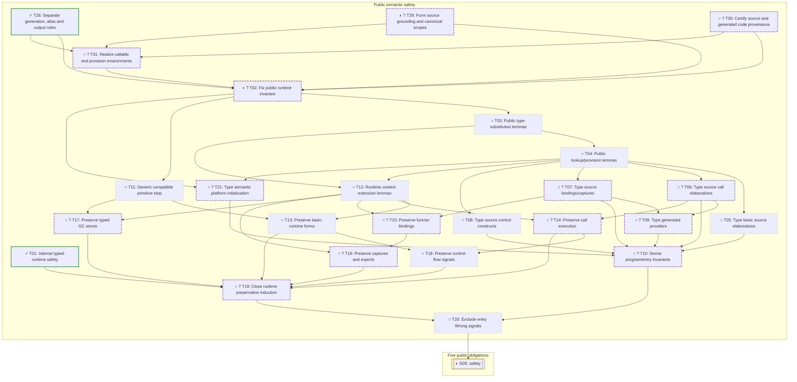

# Semantic safety

[Milestone overview and roadmap policy](../PROOFS.md). [Other branch](build-run.md).

Generated from [one canonical task plan](../proof-plan.json). Task IDs and finish conditions are shared across views.

[Current focus](#current-focus) · [Diagram](#safety-dependency-detail) · [Task records](#task-records)

Ready tasks with tentative hour estimates: none.

Ready tasks needing decomposition: [T29](#t29), [T30](#t30).

## Current focus

[T02](#t02), [T29](#t29), [T30](#t30), [T31](#t31). T02 is the assembly milestone; the formation, provenance and
environment-realization gaps remain explicit in T29, T30 and T31.

Before starting a frontier task, name the checked result expected within roughly
an hour. At the checkpoint compare its remaining gap with the previous one.
If helper results accumulate without shrinking that gap, reevaluate the approach.

## Safety dependency detail

Arrows show prerequisites within this diagram. Completed helper refinements
are folded into the catalog; other diagrams' prerequisites are linked below.

| Task in this diagram | Prerequisite outside the diagram |
| --- | --- |
| [T02](#t02) | [T23](#t23) |
| [T02](#t02) | [T24](#t24) |
| [T02](#t02) | [T25](#t25) |
| [T13](#t13) | [T24](#t24) |
| [T16](#t16) | [T22](#t22) |
| [T17](#t17) | [T25](#t25) |
| [T26](#t26) | [T28](#t28) |
| [T31](#t31) | [T23](#t23) |

## Task records

Each finish condition and its evidence has one home. Prerequisites link
to that record, including across diagrams and pages.

### Public semantic safety

| Task | Status / budget | Finish condition | Prerequisites | Strategy and evidence |
| --- | --- | --- | --- | --- |
|  **T01** Internal typed-runtime safety | ✓ done; Proved / defined | typed_runtime_program implies that internal run_main never returns XErr. | None | Existing proof; no assertion that all accepted programs have certificates. Named result: `typed_runtime_never_err`.  [XElabTyped.v](../theories/XElabTyped.v) |
|  **T02** Fix public runtime invariant | ◐ partial; ? Decompose | Define public typing/provision/store invariants strong enough for safety of all admissible semantic programs. | [T23](#t23), [T24](#t24), [T25](#t25), [T26](#t26), [T29](#t29), [T30](#t30), [T31](#t31) | Assemble the checked data/heap/local invariant and generation protocol with source formation, generated-code provenance and inductive callable/environment realization. Use source derivations directly and fuel induction; do not build a second full expression typing calculus.  [PublicValueTyping.v](../theories/PublicValueTyping.v), [PublicCastTyping.v](../theories/PublicCastTyping.v), [PublicHeapTyping.v](../theories/PublicHeapTyping.v), [Audit.v](../theories/Audit.v) |
|  **T03** Public type-substitution lemmas | ○ open; ≤1h, tentative | Public typing/grounding admits the substitution and grounding facts required by runtime calls and result exports. | [T02](#t02) | Structural proofs over the settled typing and environment judgments.  [Audit.v](../theories/Audit.v), [XTyping.v](../theories/XTyping.v) |
|  **T04** Public lookup/provision lemmas | ○ open; ≤1h, tentative | Typed environments provide correctly typed values, functions, methods and functors at the keys used by execution. | [T03](#t03) | Prove Satisfies_select_ready: exact public rkey agreement and typed selected provisions under instantiated semantic grounding. Invert inductive environment realization; keep source canonicalization/merge prerequisites explicit.  [Audit.v](../theories/Audit.v), [XProvision.v](../theories/XProvision.v) |
|  **T05** Type basic source elaborations | ○ open; ≤1h, tentative | Public literal, record, tag and basic expression elaboration preserves the new runtime typing invariant. | [T04](#t04) | Induct over the corresponding public elaboration rules.  [Audit.v](../theories/Audit.v) |
|  **T06** Type source call elaborations | ○ open; ? Decompose | Ordinary, method and family-call elaborations yield correctly typed runtime calls. | [T04](#t04) | Split call forms, satisfaction maps and generated methods once T02 is fixed.  [Audit.v](../theories/Audit.v), [XBridge.v](../theories/XBridge.v) |
|  **T07** Type source bindings/captures | ○ open; ? Decompose | Public BindItems and provider derivations preserve runtime provision/capture typing. | [T04](#t04) | Prove FnProvider_capture_ready, followed by method/lambda and functor variants: planned captures realize the certified code context and grounded signatures agree.  [Audit.v](../theories/Audit.v), [XBridgeCtx.v](../theories/XBridgeCtx.v) |
|  **T08** Type source control constructs | ○ open; ≤1h, tentative | Match, loop, return and branch elaboration preserve runtime typing and control permissions. | [T04](#t04) | Induct over source control rules using the settled frame invariant.  [Audit.v](../theories/Audit.v) |
|  **T09** Type generated providers | ○ open; ? Decompose | Lambda, forwarder, wrapper and linked-provider derivations generate typed callable code with correct interfaces. | [T06](#t06), [T07](#t07) | Separate generated-body forms and discharge their closure environments.  [Audit.v](../theories/Audit.v), [ReifyContracts.v](../theories/ReifyContracts.v) |
|  **T10** Derive program/entry invariants | ○ open; ? Decompose | Every public ElaboratesIn plus Linked witness establishes runtime code validity and a typed initial entry environment. | [T05](#t05), [T06](#t06), [T07](#t07), [T08](#t08), [T09](#t09), [T21](#t21) | Assemble the public semantic derivation; cover all admissible programs, not just executable build outputs.  [Audit.v](../theories/Audit.v) |
|  **T11** Generic compatible primitive step | ○ open; ≤1h, tentative | Any compatible interface preserves the public typed result/store invariant for a primitive step. | [T02](#t02) | Use Compatible.interface_laws; do not assume the interface is the default host.  [Audit.v](../theories/Audit.v) |
|  **T12** Runtime context extension lemmas | ○ open; ≤1h, tentative | Grounding and provision typing survive the environment extensions and substitutions used by runtime evaluation. | [T03](#t03), [T04](#t04) | Prove weakening and result-generation extension facts under explicit freshness.  [Audit.v](../theories/Audit.v), [XEnv.v](../theories/XEnv.v) |
|  **T13** Preserve basic runtime forms | ○ open; ≤1h, tentative | Variables, values, records, tags and primitive expressions preserve the public runtime invariant. | [T12](#t12), [T11](#t11), [T24](#t24) | Prove evaluator case lemmas conditional on the smaller-fuel induction hypothesis.  [Audit.v](../theories/Audit.v), [XSafety.v](../theories/XSafety.v) |
|  **T14** Preserve call execution | ○ open; ? Decompose | Function/method calls preserve runtime typing and caller state/environment obligations. | [T12](#t12), [T06](#t06) | Adapt the call cases after argument/callable invariants are fixed; split direct and provision calls if needed.  [Audit.v](../theories/Audit.v), [XSafety.v](../theories/XSafety.v) |
|  **T15** Preserve functor bindings | ○ open; ? Decompose | Executing unified functor/provider bindings produces correctly typed provision environments. | [T12](#t12), [T07](#t07) | Split closure creation, input application and output-generation exports.  [Audit.v](../theories/Audit.v), [XSafety.v](../theories/XSafety.v) |
|  **T16** Preserve captures and exports | ○ open; ? Decompose | Captured lexical meanings and caller output generations satisfy runtime invariants after binding/application. | [T15](#t15), [T12](#t12), [T22](#t22) | Prove LinkBody_outputs_ready: source body/result/freshness premises make provision selection and result_environment succeed, extend caller realization and preserve all old supported generations.  [Audit.v](../theories/Audit.v), [InputGenerationRuntime.v](../theories/InputGenerationRuntime.v) |
|  **T17** Preserve typed GC stores | ○ open; ? Decompose | Public heap operations preserve store typing, checked handles and non-GC state invariants for any compatible interface. | [T12](#t12), [T11](#t11), [T25](#t25) | Use generic heap laws with the public held-type interpretation, not concrete-host behavior.  [Audit.v](../theories/Audit.v), [XHeap.v](../theories/XHeap.v) |
|  **T18** Preserve control-flow signals | ○ open; ≤1h, tentative | Match/loop/return/break cases preserve typing and rule out misplaced control signals at the entry boundary. | [T13](#t13), [T14](#t14) | Case analysis using the frame/control permission invariant.  [Audit.v](../theories/Audit.v), [XSafety.v](../theories/XSafety.v) |
|  **T19** Close runtime preservation induction | ○ open; ? Decompose | Assemble all public expression/binding/application preservation cases by fuel induction. | [T01](#t01), [T13](#t13), [T14](#t14), [T16](#t16), [T17](#t17), [T18](#t18) | Port the internal induction pattern, exposing any missing evaluator cases as new tasks.  [Audit.v](../theories/Audit.v), [XSafety.v](../theories/XSafety.v) |
|  **T20** Exclude entry Wrong signals | ○ open; ≤1h, tentative | For an admissible public program and compatible interface, reference run_main cannot yield Stuck or escaping Breaking at any fuel. | [T19](#t19), [T10](#t10) | Apply preservation to the typed entry environment; invert the allowed top-level signals.  [Audit.v](../theories/Audit.v) |
|  **T21** Type semantic platform initialization | ○ open; ? Decompose | Public Platform.Linked and the source context establish the typing of the semantic initial provisions and primitive families. | [T02](#t02), [T04](#t04) | Invert the declarative platform rules. This proof does not require an executable platform checker or the concrete default-host implementation.  [Audit.v](../theories/Audit.v) |
|  **T22** Preserve closed captured meanings | ✓ done; Proved / defined | Public grounding of a type is unchanged by a new caller behind a complete captured type scope; captured provision lookups are unchanged. | None | Prove substitution agreement on mentioned generations and left-prefix lookup stability directly against Audit. Completeness of the captured scope remains explicit; semantic binding validity must still establish it. Origin: refinement under [T16](#t16). Named result: `capture_ground_stable`.  [PublicCaptureFacts.v](../theories/PublicCaptureFacts.v) |
|  **T23** Ground data and immutable heap typing | ✓ done; Proved / defined | Define public ground data/handle/local-store typing and prove heap-extension monotonicity, typed lookup and assignment, lexical scope operations and tag/handle inversion. | None | Use explicit machine types and structural record fields. Heap cells retain immutable held types; callable/environment/source obligations remain in T02. Unit declarations (`tag True;`) are typed by TypedUnitTag; typed Bool values have the shape truthy reads (bool_value_shape, truthy_typed). Origin: refinement under [T02](#t02). Named result: `typing_extends`.  [PublicValueTyping.v](../theories/PublicValueTyping.v), [PublicLocalsTyping.v](../theories/PublicLocalsTyping.v), [PublicBoolTyping.v](../theories/PublicBoolTyping.v), [PublicTypeRead.v](../theories/PublicTypeRead.v) |
|  **T24** Preserve checked public tag construction | ✓ done; Proved / defined | check_tag returns a typed tag or a defined trap given a correctly grounded payload and complete cast guard arguments. | [T23](#t23) | Prove public type equality reflection and invert checked headers. The theorem explicitly assumes the ground payload; it does not assume source elaboration already provides it. Origin: refinement under [T13](#t13). Named result: `check_tag_preserves`.  [PublicCastTyping.v](../theories/PublicCastTyping.v), [PublicTypeFacts.v](../theories/PublicTypeFacts.v) |
|  **T25** Extend typed public heaps on allocation | ✓ done; Proved / defined | Public interface heap laws preserve immutable ghost typing on successful box and array allocation. | [T23](#t23) | Lift old content predicates by value-typing monotonicity, extend the ghost heap at the fresh address, and apply the public heap weakening law. Origin: refinement under [T17](#t17). Named result: `array_preserves_heap`.  [PublicHeapTyping.v](../theories/PublicHeapTyping.v) |
|  **T26** Separate generation, alias and output roles | ✓ done; Proved / defined | The public runtime separates stable generation meanings, mutable aliases, explicit output destinations and scoped closure activation; checked helper laws preserve old supported types. | [T28](#t28) | User-approved semantic correction with Moss examples. Prove live binding/output/capture laws, exact provider activation domains and direct/bound-call regressions. Global context/code/environment realization remains in T29/T30/T31. Origin: discovery under [T02](#t02). Named result: `result_environment_preserves_supported_ground`. Retain the previous saved-type mismatch as an isolated legacy calculation and check the repaired actual binding/cast/output behavior. [PublicSavedTypeExample.v](../theories/PublicSavedTypeExample.v) [Audit.v](../theories/Audit.v), [PublicGenerationFacts.v](../theories/PublicGenerationFacts.v), [PublicCaptureScopeFacts.v](../theories/PublicCaptureScopeFacts.v), [PublicFunctorScopeExample.v](../theories/PublicFunctorScopeExample.v), [PublicGenerationCallExample.v](../theories/PublicGenerationCallExample.v) |
|  **T28** Preserve live generation helper meanings | ✓ done; Proved / defined | Actual Audit alias binding preserves grounding; successful fresh output export preserves all existing generation lookups and fully supported old types. | None | Prove disjoint snapshot writes and single-snapshot output reads directly for live helpers. Prove the BTypeBind context transition preserves alias agreement under explicit canonicalization idempotence; global source formation remains open. Origin: refinement under [T26](#t26). Named result: `result_environment_preserves_supported_ground`.  [PublicGenerationFacts.v](../theories/PublicGenerationFacts.v), [PublicAliasContext.v](../theories/PublicAliasContext.v) |
|  **T29** Form source grounding and canonical scopes | ◐ partial; ? Decompose | WorldOf plus CtxOf/FunCtx establish canonicalization, semantic grounding, type scope/support and merge absorption needed by runtime realization. | None | Idempotence of actual function/functor contexts and its preservation by type/output updates are checked. Prove initial grounding, payload/signature formation and scope/support for active canonical types. Origin: refinement under [T02](#t02).  [PublicContextFacts.v](../theories/PublicContextFacts.v), [Audit.v](../theories/Audit.v) |
|  **T30** Certify source and generated code provenance | ○ open; ? Decompose | Give each reachable runtime code body its existing public source derivation or a small explicit generated-shape certificate. | None | Cover FnElab/BlkE, lambda capture prologues, FPForward, MPWrapped, LinkBody refiling and Platform.Family. Unused arbitrary table entries need no certificate; ordinary recursion is handled by smaller execution fuel. Origin: refinement under [T02](#t02).  [Audit.v](../theories/Audit.v) |
|  **T31** Realize callable and provision environments | ○ open; ? Decompose | Define inductive environment/provision realization with an external semantic grounding, supported runtime type rows, exact provision keys and finite captured environments. | [T23](#t23), [T26](#t26), [T29](#t29), [T30](#t30) | Function/method closures carry code provenance and grounded signature equality; forwarders need only inspected-code support. Functors carry link/copy-chain provenance and fixed-input agreement; primitives carry AtKey and held-header typing. Origin: refinement under [T02](#t02).  [PublicValueTyping.v](../theories/PublicValueTyping.v), [PublicAliasContext.v](../theories/PublicAliasContext.v), [PublicCaptureScopeFacts.v](../theories/PublicCaptureScopeFacts.v), [Audit.v](../theories/Audit.v) |

### Five public obligations

| Task | Status / budget | Finish condition | Prerequisites | Strategy and evidence |
| --- | --- | --- | --- | --- |
|  **G05** safety | ◐ partial; ≤1h, tentative | Implement semantic safety: Admissible and Compatible imply no Runs result is Wrong. | [T20](#t20) | Unfold Runs and observe, then contradict reference entry signal safety. This has no executable build/run prerequisite. Checked: safety_from_entry derives the CORRECT.safety statement from entry_never_stuck (T20's statement; run_main never returns Breaking), and stuck_entry_is_wrong shows the reduction is exact. G05 closes when T20 is proved.  [Audit.v](../theories/Audit.v), [PublicSafety.v](../theories/PublicSafety.v) |

## Regression evidence outside the DAG

**T27**, evidence for [T26](#t26): A regression justifies and tests the repair; reproducing the old bug is not a prerequisite of the final safety proof.

<!-- Generated by bootstrap/proof-roadmap.py; edit proof-plan.json. -->
